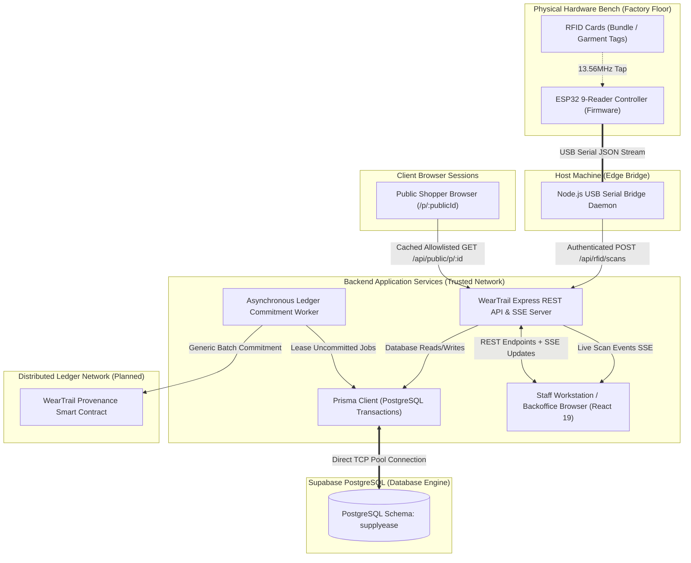
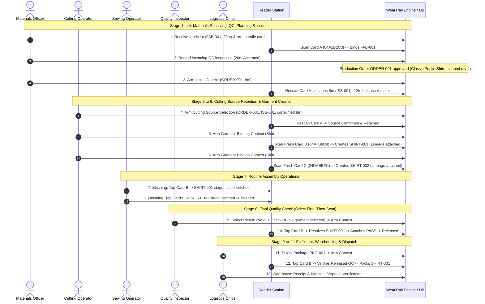
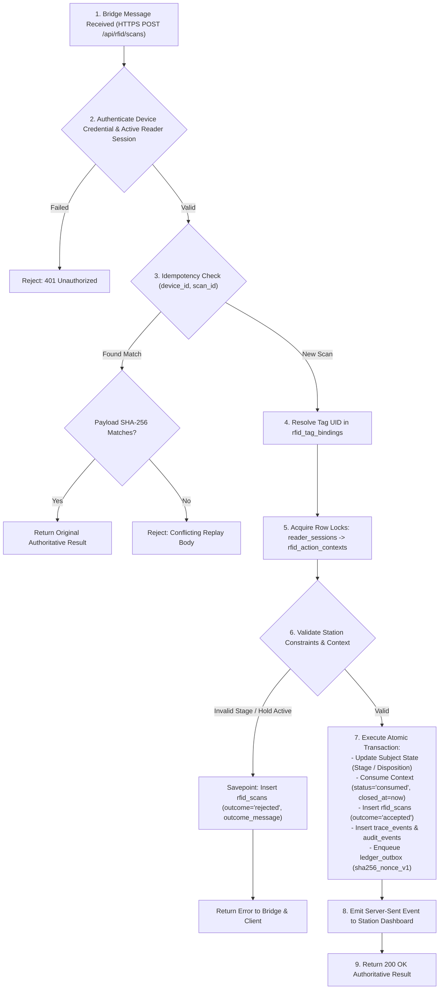
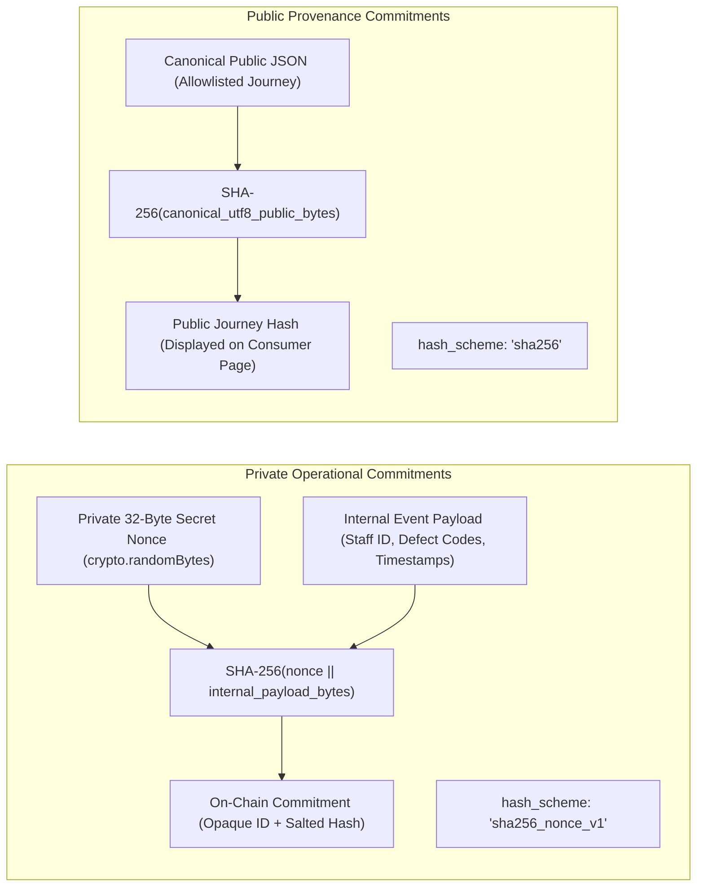
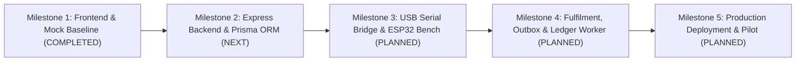

# WearTrail Project Context & System Architecture

> **Document Metadata**  
> **Last-Reviewed Date:** 19 November 2026  
> **Baseline Commit:** `fdc465242b64dc0d940b032b5c74c3578d62e3a3` (`fdc4652`)  
> **Repository Purpose:** Garment traceability, multi-station factory workflow execution, and public journey verification.  
> **Applicability:** Mandatory onboarding context for new engineering teammates and autonomous coding agents.

---

## Table of Contents

1. [Purpose, Scope, and Targeted Outcomes](#1-purpose-scope-and-targeted-outcomes)
2. [Current Implementation and Repository Map](#2-current-implementation-and-repository-map)
3. [Actors, Permissions, and Team Ownership](#3-actors-permissions-and-team-ownership)
4. [Core Concepts and Database Relationships](#4-core-concepts-and-database-relationships)
5. [Nine Physical Stations and Hardware Assumptions](#5-nine-physical-stations-and-hardware-assumptions)
6. [Complete Operational Workflow](#6-complete-operational-workflow)
7. [States, Contracts, and Backend Processing Plan](#7-states-contracts-and-backend-processing-plan)
8. [Public Journey and Blockchain/Privacy Boundaries](#8-public-journey-and-blockchainprivacy-boundaries)
9. [Functional and Nonfunctional Requirements](#9-functional-and-nonfunctional-requirements)
10. [Edge-Case Matrix](#10-edge-case-matrix)
11. [Development, Integration, and Deployment Plan](#11-development-integration-and-deployment-plan)
12. [Team & Coding Agent Onboarding Guide](#12-team--coding-agent-onboarding-guide)

---

## 1. Purpose, Scope, and Targeted Outcomes

### 1.1 System Purpose
WearTrail is an industrial garment traceability and factory workflow system. It replaces paper traveler sheets and legacy manual presence sensors with a connected **nine-reader RFID prototype**. WearTrail tracks raw materials from initial fabric bundle receipt through multi-order cutting, stitching assembly, finishing, quality assurance, packaging, warehousing, and dispatch. It concurrently projects an anonymized, cryptographically verifiable public product journey for retail consumers.

### 1.2 Targeted Observable Outcomes
The system guarantees the following end-to-end operational outcomes:

1. **Unbroken Raw-to-Garment Lineage:** Traces any finished garment back to the exact physical fabric bundle (`material_lots`), its issuing movement (`material_stock_movements`), and the approved production order (`production_orders`) that authorized its manufacture.
2. **Automated RFID Subject Resolution:** Automatically resolves the subject identity (fabric bundle or individual garment) from a physical RFID card scan without requiring operators to manually search for or preselect subject IDs.
3. **Audited Factory Milestones:** Records authorized factory operations with authoritative server-stamped UTC timestamps, device ID, reader station, operator identity, and immutable execution contexts.
4. **Coherent Material Balances:** Maintains material stock and issue balances preventing double consumption, negative balances, or order misattribution across split cutting jobs.
5. **Quality & Hold Enforcement Gates:** Dynamically blocks Packing, Warehousing, and Dispatch until quality clearance (`released`) is satisfied and all active holds (quality, operational, recall) are cleared.
6. **Immutable Failure & Rework History:** Retains inspection failures, defect notes, rework cases, repair performer logs, and reinspection results as permanent audit history. A successful repair reinspection never overwrites the original failure.
7. **Zero-Knowledge Asynchronous Ledger Commitments:** Publishes private operational event hashes to an asynchronous ledger outbox using salted commitments (`sha256_nonce_v1`), strictly concealing defect notes, worker identities, and private operational data from public distributed ledgers.
8. **Anonymous Consumer Journey:** Serves an accessible, responsive public journey at `/p/:publicId` reflecting current garment release status and public payload hashes without requiring logins, customer accounts, or wallet connections.
9. **Four-Domain Modular Team Implementation:** Enables four independent engineering sub-teams to build against strictly typed domain interfaces and shared DTO contracts without cross-domain regression.

### 1.3 Scope Boundaries & Non-Goals

| Feature / Concept | Scope Status | System Rule / Boundary |
|---|---|---|
| **Product Photos & Media Uploads** | **Excluded (Superseded)** | Older Lovable photo upload requirements are obsolete. No photo uploads, camera capture, or media storage infrastructure exist or are required. |
| **Colour & Size Attributes** | **Optional Metadata** | Garment-level colour and size are purely optional metadata. When absent or empty, they are completely hidden in both staff and public UIs. |
| **Product Name & Type** | **Required Specification** | Product specifications (`product_spec_versions`) and production orders define mandatory product names. Raw fabric bundles are labelled by material name, never by finished product type. |
| **Consumer Accounts & Wallets** | **Excluded (Non-Goal)** | No user signups, consumer profiles, Web3 wallets, MetaMask integrations, or crypto transactions are permitted in public routes. |
| **NFTs & Token Minting** | **Excluded (Non-Goal)** | Garments are physical items with public verification records; no ERC-721/1155 NFT minting or transferable digital asset ownership is supported. |
| **Ecommerce & Cart Checkout** | **Excluded (Non-Goal)** | WearTrail is an operational manufacturing and provenance verification tool, not an ecommerce storefront. |

---

## 2. Current Implementation and Repository Map

### 2.1 Technology Stack & Manifest Baseline

The repository is a TypeScript full-stack monorepo built on the Lovable TanStack Start architecture.

| Layer | Package / Tool | Verified Version | Configuration File / Evidence Path |
|---|---|---|---|
| **Framework** | `@tanstack/react-start` | `1.168.60` | [package.json](package.json#L50) |
| **Routing** | `@tanstack/react-router` | `1.170.41` | [package.json](package.json#L49), [src/routeTree.gen.ts](src/routeTree.gen.ts) |
| **Runtime / Build Engine** | `vite` / `nitro` | `vite: 8.1.5`, `nitro: 3.0.260603-beta` | [package.json](package.json#L89-L93), [vite.config.ts](vite.config.ts) |
| **UI Library** | `react` / `react-dom` | `^19.2.0` | [package.json](package.json#L59-L61) |
| **Styling** | `tailwindcss` | `^4.2.1` | [package.json](package.json#L67), [src/styles.css](src/styles.css) |
| **Primitive Components** | Radix UI primitives | Various (`^1.1.8` - `^2.2.16`) | [package.json](package.json#L21-L46), [src/components/ui/](src/components/ui/) |
| **Icons** | `lucide-react` | `^0.575.0` | [package.json](package.json#L58) |
| **Form Management** | `react-hook-form` / `zod` | `rhf: ^7.71.2`, `zod: ^3.25.76` | [package.json](package.json#L62-L71) |
| **Unit & Integration Testing** | `vitest` / `@testing-library/react` | `vitest: ^4.1.10`, `react: ^16.0.0` | [vitest.config.ts](vitest.config.ts), [src/test/workflow.test.ts](src/test/workflow.test.ts) |
| **Linting & Formatting** | `eslint` / `prettier` | `eslint: ^9.32.0`, `prettier: ^3.7.3` | [eslint.config.js](eslint.config.js), [.prettierrc](.prettierrc) |

### 2.2 Repository Directory Structure

```
WearTrail/
├── AGENTS.md                          # Lovable & project architectural boundary constraints
├── PROJECT_CONTEXT.md                 # Single source of truth for architecture and onboarding
├── README.md                          # Prototype overview and local launch instructions
├── package.json                       # Dependency and script manifests
├── vite.config.ts                     # Vite build configuration with TanStack Start plugin
├── vitest.config.ts                   # Vitest testing configuration (JSDOM environment)
├── src/
│   ├── app/                           # Navigation, session, and application shell wrappers
│   │   ├── auth.ts                    # Staff authentication context and state hooks
│   │   ├── navigation.tsx             # Abstracted router-independent navigation links
│   │   ├── paths.ts                   # Strict typed route paths (26 paths)
│   │   ├── session.ts                 # Local storage session token management
│   │   ├── StaffShell.tsx             # Workspace navigation sidebar and header shell
│   │   └── StaffWorkspace.tsx         # Workspace provider wrapper
│   ├── components/
│   │   ├── ui/                        # Low-level shadcn/radix UI primitives
│   │   └── wt/                        # WearTrail domain UI components (badges, layout, cards)
│   ├── domain/                        # Pure domain definitions and permission logic
│   │   ├── labels.ts                  # Human-readable labels for stations, stages, outcomes
│   │   ├── permissions.ts             # Role- and department-scoped capability functions
│   │   ├── public-types.ts            # Restricted public DTOs (shopper journey allowlist)
│   │   └── types.ts                   # Authoritative internal domain entities and RFID DTOs
│   ├── features/                      # Feature-scoped modular presentation views
│   │   ├── account/                   # Staff user profile and password change
│   │   ├── admin/                     # User management and role grant provisioning
│   │   ├── audit/                     # System-wide operational and security audit logs
│   │   ├── credentials/               # Staff credential token activation/reset view
│   │   ├── fulfilment/                # Package assembly and shipment dispatch queue
│   │   ├── garments/                  # Garment registry, history, and detail views
│   │   ├── landing/                   # Public landing hero and tracking redirect
│   │   ├── ledger/                    # Asynchronous blockchain commitment inspector
│   │   ├── login/                     # Staff authentication entry point
│   │   ├── material-lots/             # Raw fabric bundle receiving and lot detail
│   │   ├── overview/                  # Factory management KPI and status overview
│   │   ├── production-orders/         # Order planning, specification approval, and detail
│   │   ├── public-journey/            # Customer journey (/p/:publicId) and technical proof
│   │   ├── quality/                   # QC inspections queue and inspection detail view
│   │   ├── reports/                   # Operational throughput and defect reports
│   │   ├── rework/                    # Active quality holds and rework case management
│   │   ├── settings/                  # Hardware bridge status and station mapping config
│   │   ├── shared/                    # Reusable feature forms, tables, and subject headers
│   │   ├── shipments/                 # Outbound shipment manifests and departure gates
│   │   ├── tasks/                     # Department-filtered work queues
│   │   └── workstation/               # Hardware station shell and 6 feature panels
│   │       ├── WorkstationView.tsx    # Workstation route container with legacy IR toggle
│   │       └── panels/                # StationShell + 6 dedicated feature panels
│   ├── lib/
│   │   ├── data/
│   │   │   ├── client.ts              # Abstract typed WearTrailClient contract
│   │   │   └── provider.tsx           # React context provider for WearTrailClient
│   │   └── utils.ts                   # Styling utilities (cn helper)
│   ├── mock/                          # Client-side mock backend and state engine
│   │   ├── engine.ts                  # Pure state transition and constraint engine
│   │   ├── fixtures.ts                # Synthetic demo seed (DEMO_STATE_VERSION = 5)
│   │   ├── mock-client.ts             # In-memory implementation of WearTrailClient
│   │   ├── projection.ts              # Public DTO projection generator (allowlist filter)
│   │   ├── public-fixtures.ts         # Pre-baked public journey fixture fallbacks
│   │   └── store.ts                   # LocalStorage persistence manager
│   ├── routes/                        # TanStack Start file-based routing tree (26 routes)
│   └── test/                          # Unit and integration test suites
│       ├── app-routing.test.tsx       # Smoke tests for routing wrappers
│       └── workflow.test.ts           # 11 comprehensive lifecycle and constraint tests
```

### 2.3 Comprehensive 26-Route Map

All 26 route files in `src/routes/` are thin wrappers specifying route parameters, static metadata (`staticData.access`), and rendering a single feature view. In accordance with [AGENTS.md](AGENTS.md), views never import `@tanstack/react-router` directly; they use [src/app/navigation.tsx](src/app/navigation.tsx) and [src/app/paths.ts](src/app/paths.ts).

| Route Index | URL Path Pattern | Route File Location | Feature View Component | Access Role / Policy | Status |
|---|---|---|---|---|---|
| 1 | `/` | `src/routes/index.tsx` | `LandingView` | Public | **Implemented** |
| 2 | `/p/$publicId` | `src/routes/p/$publicId/index.tsx` | `PublicJourneyView` | Public (Anonymous) | **Implemented** |
| 3 | `/p/$publicId/proof` | `src/routes/p/$publicId/proof.tsx` | `PublicProofView` | Public (Anonymous) | **Implemented** |
| 4 | `/staff/login` | `src/routes/staff/login.tsx` | `LoginView` | Public / Unauthenticated | **Implemented** |
| 5 | `/staff/credentials/$token` | `src/routes/staff/credentials.$token.tsx` | `StaffCredentialsView` | Public (Activation token) | **Implemented** |
| 6 | `/staff` | `src/routes/staff/_workspace/index.tsx` | `OverviewView` | Staff (`staff`) | **Implemented** |
| 7 | `/staff/workstation` | `src/routes/staff/_workspace/workstation.tsx` | `WorkstationView` | Operational Staff | **Implemented** |
| 8 | `/staff/material-lots` | `src/routes/staff/_workspace/material-lots/index.tsx` | `LotsView` | Materials / Production | **Implemented** |
| 9 | `/staff/material-lots/$lotId` | `src/routes/staff/_workspace/material-lots/$lotId.tsx` | `LotDetailView` | Materials / Production | **Implemented** |
| 10 | `/staff/production-orders` | `src/routes/staff/_workspace/production-orders/index.tsx` | `OrdersView` | Management / Production | **Implemented** |
| 11 | `/staff/production-orders/$orderId`| `src/routes/staff/_workspace/production-orders/$orderId.tsx`| `OrderDetailView` | Management / Production | **Implemented** |
| 12 | `/staff/garments` | `src/routes/staff/_workspace/garments/index.tsx` | `GarmentsView` | All Staff | **Implemented** |
| 13 | `/staff/garments/$garmentId` | `src/routes/staff/_workspace/garments/$garmentId.tsx` | `GarmentDetailView` | All Staff | **Implemented** |
| 14 | `/staff/quality` | `src/routes/staff/_workspace/quality/index.tsx` | `QualityView` | Quality / Management | **Implemented** |
| 15 | `/staff/quality/inspections/$inspectionId`| `src/routes/staff/_workspace/quality/inspections/$inspectionId.tsx`| `InspectionDetailView`| Quality / Management | **Implemented** |
| 16 | `/staff/rework` | `src/routes/staff/_workspace/rework/index.tsx` | `ReworkView` | Quality / Production | **Implemented** |
| 17 | `/staff/rework/$caseId` | `src/routes/staff/_workspace/rework/$caseId.tsx` | `ReworkCaseDetailView` | Quality / Production | **Implemented** |
| 18 | `/staff/fulfilment` | `src/routes/staff/_workspace/fulfilment.tsx` | `FulfilmentView` | Logistics / Warehouse | **Implemented** |
| 19 | `/staff/shipments` | `src/routes/staff/_workspace/shipments/index.tsx` | `ShipmentsView` | Logistics / Management | **Implemented** |
| 20 | `/staff/shipments/$shipmentId` | `src/routes/staff/_workspace/shipments/$shipmentId.tsx` | `ShipmentDetailView` | Logistics / Management | **Implemented** |
| 21 | `/staff/tasks` | `src/routes/staff/_workspace/tasks.tsx` | `TasksView` | Departmental Staff | **Implemented** |
| 22 | `/staff/ledger` | `src/routes/staff/_workspace/ledger.tsx` | `LedgerView` | All Staff / Auditor | **Implemented** |
| 23 | `/staff/audit` | `src/routes/staff/_workspace/audit.tsx` | `AuditView` | Admin / Management | **Implemented** |
| 24 | `/staff/reports` | `src/routes/staff/_workspace/reports.tsx` | `ReportsView` | Management / Auditor | **Implemented** |
| 25 | `/staff/settings` | `src/routes/staff/_workspace/settings.tsx` | `SettingsView` | Admin / Engineering | **Implemented** |
| 26 | `/staff/account` | `src/routes/staff/_workspace/account.tsx` | `AccountView` | Authenticated Staff | **Implemented** |
| *Extra*| `/staff/admin/users` | `src/routes/staff/_workspace/admin/users.tsx` | `UserAdminView` | System Admin (`admin`) | **Implemented** |

### 2.4 Target Backend & System Runtime Architecture

The production deployment targets an Express + Prisma backend on Node.js, backed by a Supabase PostgreSQL database and an asynchronous blockchain commit worker.



### 2.5 Process Allocation & Boundary Responsibilities

| Process Name | Execution Host | Responsibilities | Security & Network Boundary |
|---|---|---|---|
| **Controller Firmware** | ESP32 Microcontroller | Polls RC522 reader modules, detects card UIDs, echoes active `actionContextId`, streams JSON envelopes over USB UART. | Physical bench device; no IP network stack; local serial only. |
| **USB Bridge Daemon** | Host Laptop (On-Premise) | Reads USB COM port line-by-line, buffers messages, attaches hardware device credentials, forwards scans to Express over HTTPS/mTLS. | Edge network; holds device token; must not execute business logic. |
| **WearTrail Express API** | Node.js Backend Server | Authenticates staff & devices, manages reader sessions, executes pure domain transactions, emits SSE events, serves public API. | Private server / container; full access to database connection string. |
| **PostgreSQL Database** | Supabase Managed Postgres | Enforces schema constraints, foreign keys, deferred triggers, and concurrency locks under schema `supplyease`. | Private database subnet; Data API exposure revoked from `anon`/`authenticated`. |
| **Ledger Outbox Worker** | Node.js Worker Daemon | Polls `ledger_outbox`, generates private nonces (`sha256_nonce_v1`), submits commitment transactions to blockchain, updates status. | Trusted backend worker; isolated from browser code. |
| **WearTrail Frontend** | Staff / Public Browsers | Presentation layer (React 19, TanStack Start). Interacts solely through `WearTrailClient` interface. | Untrusted client execution; zero database or ledger credentials. |

---

## 3. Actors, Permissions, and Team Ownership

### 3.1 Role & Department Responsibilities

WearTrail enforces strict **role-based and department-scoped authorization**. An administrative role alone does not confer operational factory permissions.

| Staff Role | Department Scope | Authorized Operations & Boundaries | Forbidden Operations |
|---|---|---|---|
| **Administrator (`admin`)** | Administration (`administration`) | Technical configuration, managing user accounts, provisioning role grants, viewing hardware mappings and system audit logs. | Cannot record factory operations, issue materials, perform cuts, or submit quality inspections. |
| **Manager (`manager`)** | Administration (`administration`) | Approving production orders, reviewing department queues, viewing inspection results, auditing metrics, and managing overall factory schedule. | Cannot submit QC inspection decisions or execute station scans. |
| **Materials Officer (`materials`)** | Receiving (`receiving`), Raw Store (`raw_store`) | Receiving fabric bundles (`fabric_receiving`), binding bundle RFID cards, issuing fabric against approved orders (`fabric_issue`), adjusting inventory. | Cannot perform garment cutting, advance sewing stages, or approve QC. |
| **Production Operator (`production`)** | Cutting (`cutting`), Stitching (`stitching`), Finishing (`finishing`) | Confirming cutting source fabric, binding garment cards (`cutting`), routine RFID scan advancement at Stitching and Finishing stations. | Cannot approve incoming material, submit final QC, pack, or dispatch. |
| **Quality Inspector (`quality`)** | Quality (`quality`) | Performing physical garment checks, selecting Pass/Fail decisions with required defect codes, submitting final QC (`final_qc`), opening holds/rework. | Cannot perform repairs (repairer and approving reinspector must be independent). |
| **Logistics Officer (`logistics`)** | Packing (`packing`), Warehouse (`warehouse`), Shipping (`shipping`) | Verifying QC clearance, packing finished garments (`packing`), recording warehouse stock bin receipt (`warehouse`), verifying manifests and dispatching (`dispatch`). | Cannot bypass quality hold gates or dispatch unverified shipments. |
| **Anonymous Shopper (`public`)** | None (Public internet) | Viewing garment public provenance, verified timeline, material lot origin, and technical cryptographic proof at `/p/:publicId`. | Completely read-only; strictly filtered through server allowlist. |

### 3.2 Frontend Navigation vs. Server-Authoritative Guards

1. **Client Navigation Controls:** UI elements, menu items, and station action buttons use `can.*` capability functions ([src/domain/permissions.ts](src/domain/permissions.ts)) to show, hide, or disable controls based on the current staff actor.
2. **Server-Authoritative Enforcement:** Every mutation in the mock engine ([src/mock/engine.ts](src/mock/engine.ts)) and future Express API re-verifies staff session validity, active role grant, and department alignment. Any mismatch immediately aborts the transaction with an unauthorized rejection code (`WT_ERR_FORBIDDEN` / `23514`).

### 3.3 Synthetic Demo Accounts

The prototype environment initializes with verified synthetic accounts in [src/mock/fixtures.ts](src/mock/fixtures.ts). Passwords are synthetic demo placeholders.

| Full Name | Email Address | Role | Department | Demo Access Scope |
|---|---|---|---|---|
| **Alex Rivera** | `admin@weartrail.internal` | `admin` | Administration | System settings, user administration, audit viewer |
| **Morgan Chen** | `manager@weartrail.internal` | `manager` | Administration | Order approval, factory KPI oversight, read-only QC review |
| **Samira Khan** | `materials@weartrail.internal` | `materials` | Receiving / Raw Store | Bundle card assignment, fabric issue to orders |
| **Marcus Vance** | `cutting@weartrail.internal` | `production` | Cutting / Production | Source confirmation, garment card binding, sewing stages |
| **Elena Rossi** | `quality@weartrail.internal` | `quality` | Quality Assurance | Inspection submission, defect reporting, hold creation |
| **David Kim** | `logistics@weartrail.internal` | `logistics` | Packing / Shipping | Package aggregation, warehouse binning, dispatch execution |

### 3.4 Four-Member Engineering Team Ownership Matrix

To prevent merge conflicts and duplicate implementations, the system is partitioned into four clear domains:

| Domain | Owning Sub-Team | Core Responsibilities & Feature Folders | Shared Contracts Owned |
|---|---|---|---|
| **1. Staff Foundation** | Team Member 1 | Shared UI/session/client contracts, account profile, login, credential token flow, system settings, device mapping UI. Folders: `src/app/`, `src/lib/data/client.ts`, `src/features/account/`, `src/features/settings/`, `src/features/admin/`, `src/features/login/`. | [src/lib/data/client.ts](src/lib/data/client.ts), [src/domain/types.ts](src/domain/types.ts), [src/app/navigation.tsx](src/app/navigation.tsx) |
| **2. Materials & Production** | Team Member 2 | Fabric bundle receiving, order planning, order approvals, fabric issuing, cutting source retention, garment creation, sewing queues, shared station shell. Folders: `src/features/material-lots/`, `src/features/production-orders/`, `src/features/garments/`, `src/features/tasks/`, `src/features/workstation/`. | `ReceivingPanel.tsx`, `IssuePanel.tsx`, `CuttingPanel.tsx`, `RoutinePanel.tsx`, `StationShell.tsx` |
| **3. Quality & Fulfilment** | Team Member 3 | QA station panel, inspections queue, checklist verification, quality holds, rework case management, packing, warehouse bins, dispatch manifests. Folders: `src/features/quality/`, `src/features/rework/`, `src/features/fulfilment/`, `src/features/shipments/`. | `QAPanel.tsx`, `LogisticsPanel.tsx`, hold releasing protocols, packing validation logic |
| **4. Ledger & Public** | Team Member 4 | Blockchain commitment monitor, outbox worker interfaces, audit logs, analytics reports, public shopper journey, cryptographic proof views. Folders: `src/features/ledger/`, `src/features/audit/`, `src/features/reports/`, `src/features/public-journey/`, `src/mock/projection.ts`. | [src/domain/public-types.ts](src/domain/public-types.ts), [src/mock/projection.ts](src/mock/projection.ts), public journey schemas |

---

## 4. Core Concepts and Database Relationships

### 4.1 Domain Entity Glossary

- **Material Lot (`material_lots`):** Represents one physical fabric bundle received from a supplier. Carries a material name, quantity (in meters), test results, and **one active RFID card**.
- **Product Specification (`product_spec_versions`):** Digital specification defining a garment model name, standard material requirements, and production instructions.
- **Production Order (`production_orders`):** Digital production authorization for a planned garment quantity of an approved specification. **Orders have no RFID cards.**
- **Material Stock Movement (`material_stock_movements`):** Immutable ledger record tracking fabric quantity transitions (e.g., `accepted`, `issued`, `unused_return`).
- **Cutting Job & Input (`cutting_jobs`, `cutting_inputs`):** Production run where issued fabric is cut into garment components. `cutting_inputs` records the actual issued movement and consumed meters.
- **Garment (`garments`):** Individual physical product created at Cutting. Has an internal UUID, staff human-readable code (`SHIRT-001`), permanent public tracking ID (`WT-SH-001`), and **its own separate RFID card**.
- **RFID Tag Binding (`rfid_tag_bindings`):** Mapping connecting a normalized RFID UID to **exactly one** subject (`material_lot_id` OR `garment_id`).
- **Reader Station (`rfid_stations`):** One of nine physical or logical checkpoints in the manufacturing sequence.
- **Reader Session (`reader_sessions`):** Exclusive assignment granting one authorized operator control over one mapped reader.
- **Action Context (`rfid_action_contexts`):** Immutable server-generated context (UUID) binding operator selections (order, quantity, QC outcome) to a reader session before a card is scanned.
- **RFID Scan (`rfid_scans`):** Immutable record of a physical card read, including device ID, sequence, timestamp, resolved subject, outcome (`accepted` or `rejected`), and error reasons.
- **Inspection (`inspections`):** Quality evaluation record linked directly to an accepted RFID scan, carrying checklist answers, outcome (`pass` or `fail`), and defect codes.
- **Garment Hold (`garment_holds`):** Blocking flag (`quality`, `operational`, `recall`) that prevents downstream packing or dispatch until formally released.
- **Rework Case & Repair (`rework_cases`, `repair_records`):** Corrective workflow tracking defect repair actions and requiring independent reinspection.
- **Package (`packages`, `package_items`):** Physical carton containing verified finished garments.
- **Warehouse Bin (`warehouse_bins`):** Storage location for sealed packages or finished garments.
- **Shipment (`shipments`, `shipment_packages`):** Outbound logistics manifest tracking carriers, packages, and final departure.
- **Internal Trace Event (`trace_events`):** Fine-grained chronological milestone linking scans, inspections, and movements.
- **Ledger Commitment (`ledger_commitments`):** Cryptographic hash record queued in `ledger_outbox` for asynchronous blockchain anchoring.

### 4.2 Entity Relationships & Material Lineage

The lineage from raw fabric to customer garment strictly adheres to the database schema:

```
[material_lots (Fabric Bundle)]
       │
       ▼ (kind = 'issued')
[material_stock_movements]
       │
       ▼
[cutting_inputs] ◄── [cutting_jobs] ◄── [production_orders]
       │
       ▼
[garment_material_inputs] ──► [garments (Cut Shirts)]
                                    │
                                    ├──► [rfid_tag_bindings] (Garment Card)
                                    ├──► [inspections] (Linked via rfid_scan_id)
                                    └──► [package_items] ──► [packages] ──► [shipments]
```

**Key Architectural Invariants:**
1. **No Direct Shortcut Columns:** There is no direct `garments.material_lot_id` foreign key. Material lineage is preserved through `garment_material_inputs` → `cutting_inputs` → `material_stock_movements` → `material_lots`.
2. **Cardinality Constraints:**
   - One fabric bundle supplies multiple production orders via separate quantified issue movements.
   - One production order produces multiple distinct garments.
   - One garment references its specific cutting input and cannot attribute more fabric than was consumed during cutting (`check_garment_attributed_quantity`).
3. **Card Replacement Invariant:** Replacing an RFID card unbinds the old card (`unbound_at = clock_timestamp()`) and appends a new `rfid_tag_bindings` record. The garment's permanent UUID, public tracking ID, and history are fully preserved.

### 4.3 Database Table Categorization (58 Tables)

The underlying PostgreSQL schema is named **`supplyease`** for compatibility with the baseline migration. The product name is **WearTrail**.

| Functional Domain | Key Database Tables | Primary Constraints & Triggers |
|---|---|---|
| **Identity & Access** | `departments`, `staff_users`, `staff_role_grants`, `staff_sessions`, `staff_credential_tokens` | Multi-tenant single factory; department-role cross matching; session revocations. |
| **Hardware & RFID** | `devices`, `device_credentials`, `device_mapping_versions`, `device_reader_mappings`, `device_bridge_sessions`, `reader_sessions`, `rfid_stations`, `rfid_action_contexts`, `rfid_scans`, `rfid_tag_bindings` | Active UID uniqueness (`rfid_tags_active_uid_uq`); immutable scan history (`forbid_history_change`); bench verification guard (`reader_mapping_before_verification`). |
| **Material Management** | `suppliers`, `material_lots`, `material_stock_movements`, `material_lot_test_results` | Single active bundle card; non-negative stock balance; issue movements strictly tied to approved orders. |
| **Production Execution** | `product_spec_versions`, `production_orders`, `cutting_jobs`, `cutting_inputs`, `cutting_source_selections`, `garments`, `garment_material_inputs`, `tasks` | Garment initial state guard (`guard_new_garment_state`: stage=`cut`, disposition=`awaiting_inspection`); deferred lineage trigger (`garments_require_lineage`). |
| **Quality & Rework** | `checklists`, `checklist_versions`, `inspections`, `garment_holds`, `rework_cases`, `repair_records` | Deferred scan-to-inspection integrity (`check_completed_scan_context`); deferred failure hold trigger (`inspection_failure_requires_hold`); independent repair reinspection. |
| **Fulfilment & Logistics** | `packages`, `package_items`, `warehouse_bins`, `shipments`, `shipment_packages` | Quality clearance gate (`garment_quality_allows_fulfilment`); package eligibility guard (`check_package_item_eligibility`); dispatch departure verification (`guard_dispatch_quality`). |
| **Ledger & Public Journey** | `trace_events`, `audit_events`, `ledger_commitments`, `ledger_outbox`, `public_payload_versions`, `public_garment_release_status` (View) | Salted private nonces (`sha256_nonce_v1`); public allowlist projection; current release status view. |
| **Legacy Compatibility** | `sensors`, `observations`, `captures`, `schema_migrations` | Preserves historical IR data and checkpoints `S1`–`S6`. |

---

## 5. Nine Physical Stations and Hardware Assumptions

### 5.1 Station Topology & Mappings

The WearTrail prototype features nine distinct logical checkpoints:

| Pos | Station Name | Stable Station Code | Original Board Label | Checkpoint ID | Department Scope | Subject Kind | Action Context Required? |
|---|---|---|---|---|---|---|---|
| 1 | **Fabric Receiving** | `fabric_receiving` | Raw Material 1 | `S1` | `receiving` | `material_lot` | **Yes** (`assign_bundle_card`) |
| 2 | **Fabric Issue** | `fabric_issue` | Raw Material 2 | `RAW_ISSUE` | `raw_store` | `material_lot` | **Yes** (`confirm_issue`) |
| 3 | **Cutting & Tag Assignment** | `cutting` | Manufacturing 1 | `S2` | `cutting` | `source_and_garment` | **Yes** (`select_source` / `bind_garment`) |
| 4 | **Stitching** | `stitching` | Stitching | `S3` | `stitching` | `garment` | **No** (Routine scan advancement) |
| 5 | **Finishing** | `finishing` | Production | `S4` | `production` | `garment` | **No** (Routine scan advancement) |
| 6 | **Final Quality Check** | `final_qc` | Design | `FINAL_QC` | `quality` | `garment` | **Yes** (`submit_qc`: Pass/Fail preselected) |
| 7 | **Packing** | `packing` | Packaging | `S5` | `packing` | `garment` | **Yes** (`pack_garment`) |
| 8 | **Finished Goods Warehouse** | `warehouse` | Manufacturing 2 | `WAREHOUSE` | `warehouse` | `garment` | **Yes** (`warehouse_receive`) |
| 9 | **Dispatch** | `dispatch` | Shipping | `S6` | `shipping` | `garment` | **Yes** (`dispatch_garment`) |

### 5.2 Logical Sequence vs. Bench Hardware Reality

> [!IMPORTANT]
> **Workflow Position Numbers Are NOT ESP32 Reader Indices.**  
> The numbers 1 through 9 define the logical path of a garment through the factory. They do **not** reflect SPI chip-select pins, I2C multiplexer channels, or physical wiring order on the controller board.

Before active hardware deployment:
1. Every physical reader channel must be mapped through a draft `device_mapping_versions` record.
2. An engineer taps known test cards on each physical antenna to record physical-to-logical channel correspondences in `device_reader_mappings`.
3. The mapping is verified (`bench_verified_at = clock_timestamp()`) and activated (`activated_at = clock_timestamp()`). Once activated, database trigger `reader_mapping_before_verification` prevents any in-place edits.

### 5.3 USB Serial Bridge Message Envelope

The physical ESP32 controller communicates with the host laptop's Node.js bridge by transmitting newline-delimited JSON envelopes over USB UART (115200 baud):

```json
{
  "schemaVersion": 1,
  "deviceId": "WT-BOARD-01",
  "scanId": "boot-a91f:42",
  "bootId": "boot-a91f",
  "sequence": 42,
  "readerIndex": 5,
  "mappingVersion": 1,
  "tagUid": "04A12B7C",
  "actionContextId": "7c9e6679-7425-40de-944b-e07fc1f90ae7",
  "deviceUptimeMs": 128000
}
```

**Envelope Fields & Validation:**
- `schemaVersion`: Integer schema version (currently `1`).
- `deviceId`: Hardware identifier registered in `devices`.
- `scanId`: Monotonically increasing identifier scoped to the boot cycle (`bootId:sequence`).
- `bootId`: Random string generated on controller boot to detect board resets.
- `sequence`: Reset-safe message counter.
- `readerIndex`: Physical reader channel (0–255) reported by controller firmware.
- `mappingVersion`: Configuration version corresponding to active `device_mapping_versions`.
- `tagUid`: Normalized hex string (4, 7, or 10 bytes uppercase, e.g., `04A12B7C`).
- `actionContextId`: UUID echoed back by firmware if an explicit action was armed, or `null` for routine scans.
- `deviceUptimeMs`: Milliseconds since controller boot (used for hardware health diagnostics, not event timestamps).

### 5.4 Superseded Firmware Behaviors

The upgraded RFID architecture strictly supersedes previous firmware assumptions:
1. **No Forced Reader 1 Startup:** Firmware must not require every card to start at reader index 0. Cards are scanned dynamically at their appropriate workflow station.
2. **No Hardware Exit-Sensor QC:** The physical "Passed" exit sensor from the IR prototype is completely retired. Quality decisions are made by an authorized inspector in software, not triggered by an antenna edge.
3. **Card Uniqueness Across Subjects:** The firmware transmits raw UIDs; the backend determines whether the UID belongs to a fabric bundle or a garment via `rfid_tag_bindings`.

---

## 6. Complete Operational Workflow

The manufacturing journey spans twelve discrete, audited operational phases.



### 6.1 Detailed Stage Execution Protocols

#### Stage 1: Fabric Receiving (`fabric_receiving`)
- **Prerequisites:** Fabric bundle physically delivered by supplier with delivery note.
- **Authorized Actor:** Materials Officer (`materials` role, `receiving` department).
- **Dashboard Input:** Select supplier, enter material name (`Cotton poplin`), lot code (`FAB-001`), roll width/weight, and received quantity (`20 m`). Click **"Assign RFID Card"**.
- **Card Used:** Fresh, unbound RFID card (**Bundle Card A**).
- **Scan Flow:** Prepares `receive_bundle` context (`awaiting_ack`) → board acknowledges (`ready`) → card tapped → backend checks UID is globally unbound → creates `material_lots`, initial `material_stock_movements`, and `rfid_tag_bindings`.
- **Outcome & Downstream Effect:** Fabric bundle is active in inventory. Card A permanently represents this physical bundle.

#### Stage 2: Incoming Material QC (Dashboard)
- **Prerequisites:** Fabric lot received.
- **Authorized Actor:** Materials Officer or Quality Inspector.
- **Dashboard Input:** Enter test parameters (visual defects, thread count, colour fastness). Record quantity breakdown: `20 m` accepted, `0 m` held, `0 m` rejected.
- **Card / Hardware:** Purely software dashboard action; no hardware scan required.
- **Backend Validation:** Validates that accepted + held + rejected equals total received quantity. Updates lot status to `active` and stock balance to `20 m`.
- **Downstream Effect:** Only accepted quantities can be issued for production orders.

#### Stage 3: Production Order Planning (Dashboard)
- **Prerequisites:** Approved product specification exists in system.
- **Authorized Actor:** Factory Manager (`manager` role, `administration` department).
- **Dashboard Input:** Select product specification (`Classic Poplin Shirt`), enter planned quantity (`4 pcs`), target completion date. Save draft, then click **"Approve Order"**.
- **Card / Hardware:** Digital instruction only. **Production orders have no RFID cards.**
- **Downstream Effect:** Order status transitions to `approved`. Becomes selectable for fabric issuing.

#### Stage 4: Fabric Issue (`fabric_issue`)
- **Prerequisites:** Approved order exists; fabric lot has accepted balance.
- **Authorized Actor:** Materials Officer (`materials` role, `raw_store` department).
- **Dashboard Input:** Select approved order (`ORDER-001`), select fabric lot (`FAB-001`), specify issue quantity (`8 m`). Click **"Prepare Issue Scan"**.
- **Card Used:** Physical **Bundle Card A** (rescanned).
- **Scan Flow:** Prepares `issue_bundle` context with `{ orderId, quantity: 8 }` → board armed → Card A tapped → backend validates Card A owns `FAB-001`, balance `20m >= 8m` → deducts balance to `12 m`, creates `material_stock_movements` (kind `issued`, code `ISS-001`).
- **Downstream Effect:** Fabric is formally issued to `ORDER-001`. For another order, a fresh context must be prepared and Card A rescanned.

#### Stage 5: Cutting Source Selection (`cutting`)
- **Prerequisites:** Issued fabric delivered to cutting table; cutting job created.
- **Authorized Actor:** Production Operator (`production` role, `cutting` department).
- **Dashboard Input:** Select cutting job, select issued input (`ISS-001`), enter total consumed quantity (`8 m`) and planned output (`4 shirts`). Click **"Confirm Fabric Source"**.
- **Card Used:** Physical **Bundle Card A** (scanned at Cutting station).
- **Scan Flow:** Prepares `select_cutting_source` context → Card A tapped → backend verifies Card A matches `ISS-001` → creates active record in `cutting_source_selections`.
- **Downstream Effect:** Source selection remains locked and active on the cutting workstation. Multiple cut garments can now be created against this retained source.

#### Stage 6: Garment Creation & Card Binding (`cutting`)
- **Prerequisites:** Active cutting source confirmed on station.
- **Authorized Actor:** Production Operator (`production` role, `cutting` department).
- **Dashboard Input:** Operator groups cut fabric pieces for Shirt #1. Clicks **"Assign Next Garment Tag"**.
- **Card Used:** Fresh, unbound RFID card (**Garment Card B**).
- **Scan Flow:** Prepares `bind_garment_tag` context referencing active `source_selection_id` → Card B tapped → backend atomically:
  1. Inserts new `garments` row (`SHIRT-001`, stage: `cut`, disposition: `awaiting_inspection`).
  2. Binds Card B in `rfid_tag_bindings` (`garment_id = SHIRT-001`).
  3. Records `garment_material_inputs` attributing `2.0 m` fabric from `ISS-001`.
  4. Records accepted scan and consumes context.
- **Repetition:** Operator attaches Card B to Shirt #1 bundle. Operator clicks "Assign Next Garment Tag" and scans **Card C** for Shirt #2 (`SHIRT-002`). Bundle Card A remains with unused fabric.

#### Stage 7: Routine Assembly Operations (`stitching` & `finishing`)
- **Prerequisites:** Garment in stage `cut` (for Stitching) or `stitched` (for Finishing).
- **Authorized Actor:** Production Operator (`production` role, appropriate department).
- **Dashboard Input:** None required. Operates under an authorized, continuous `reader_sessions`.
- **Card Used:** Garment Card B.
- **Scan Flow:** Card B tapped at Stitching antenna (`S3`) → backend looks up Card B → resolves `SHIRT-001` → validates current stage is `cut` → updates stage to `stitched` → logs trace event. Finishing antenna (`S4`) advances stage to `finished`.
- **Downstream Effect:** Garment arrives at Final QC in physical stage `finished`.

#### Stage 8: Final Quality Inspection (`final_qc`)
- **Prerequisites:** Garment stage is `finished`; quality inspector logged in.
- **Authorized Actor:** Quality Inspector (`quality` role, `quality` department).
- **Dashboard Input:** Inspector physically evaluates shirt. In software, clicks **"Pass"** (or "Fail" + defect reason). Checklist items confirmed. Clicks **"Arm Inspection Scan"**. **The inspector does not search for or select a garment ID.**
- **Card Used:** Garment Card B.
- **Scan Flow:** Prepares `submit_qc` context with `{ outcome: 'pass', answers: {...} }` (no garment ID) → board armed → Card B tapped → backend resolves `SHIRT-001` from Card B → checks stage is `finished` → atomically records inspection (`pass`), updates garment `quality_disposition = 'released'`, consumes context, appends internal trace event, and enqueues ledger outbox.
- **Downstream Effect:** `SHIRT-001` is released. The dashboard clears the decision and arms the panel for the next shirt.

#### Stage 9: Quality Hold & Rework Workflow (On Failure)
- **Trigger:** Inspector selects **"Fail"**, selects defect code (`SEAM_BURST`), and scans **Card C** (`SHIRT-002`).
- **Backend Atomicity:** Deferred trigger `inspection_failure_requires_hold` requires:
  1. Inspection recorded with outcome `fail`.
  2. Garment `quality_disposition` updated to `held`.
  3. Active `garment_holds` record opened (`kind = 'quality'`).
  4. `rework_cases` opened (`status = 'open'`).
- **Repair Phase:** Production operator fixes the seam. Logs repair details in dashboard (`repair_records`: performer Marcus Vance, action description). Rework status becomes `repair_recorded`. **Repair alone does not release the hold.**
- **Reinspection Phase:** Independent inspector (Elena Rossi) arms reinspection context (Pass) and rescans Card C. Reinspection passes → releases quality hold → updates garment to `released`. Full failure history is preserved.

#### Stage 10: Packing & Package Insertion (`packing`)
- **Prerequisites:** Garment stage `finished`; quality disposition `released`; zero open holds.
- **Authorized Actor:** Logistics Officer (`logistics` role, `packing` department).
- **Dashboard Input:** Select open shipping package (`PKG-001`). Click **"Arm Packing Scan"**.
- **Card Used:** Garment Card B (`SHIRT-001`).
- **Backend Validation:** Validates `garment_quality_allows_fulfilment`:
  - Disposition is `released`.
  - Zero active rows in `garment_holds`.
  - Zero unsubmitted inspections.
  - Latest inspection outcome is `pass`.
- **Database Effect:** Inserts `package_items` row; updates garment stage `finished` → `packed`.

#### Stage 11: Warehouse Binning (`warehouse`)
- **Prerequisites:** Garment packed in sealed package, or loose finished garment.
- **Authorized Actor:** Logistics Officer (`logistics` role, `warehouse` department).
- **Dashboard Input:** Select storage bin (`BIN-NORTH-04`). Click **"Arm Bin Scan"**.
- **Card Used:** Garment Card B.
- **Database Effect:** Updates garment storage location; advances stage to `warehoused`.

#### Stage 12: Shipment Dispatch Departure (`dispatch`)
- **Prerequisites:** Shipment manifest created and approved (`shipments`).
- **Authorized Actor:** Logistics Officer (`logistics` role, `shipping` department).
- **Dashboard Input:** Select shipment (`SHIP-2026-001`), assign packages (`PKG-001`). Verify carrier details.
- **Hardware Scan & Departure Gate:**
  1. Card scan verifies package item membership.
  2. Clicking "Confirm Departure" triggers database trigger `shipments_guard_current_qc`.
  3. Re-evaluates every garment in every assigned package: if any garment has acquired a hold (e.g., recall) after shipment approval, departure is hard-blocked.
  4. On clearance: updates shipment to `dispatched` and garments to `dispatched`.

---

### 6.2 Worked Numerical Allocation Example

To guarantee mathematical consistency across inventory, cutting, and output:

#### Fabric Bundle `FAB-001`
- **Initial Received Balance:** `20.000 m` (Cotton poplin, Card UID `04A1B2C3`).
- **Incoming QC:** Accepted `20.000 m`.

#### Allocation Across Orders
1. **Production Order 1 (`ORDER-001`):**
   - Specification: *Classic Poplin Shirt* (Standard consumption: `1.800 m/shirt`).
   - Planned Quantity: `4 pcs`.
   - Issued Quantity (`ISS-001`): `8.000 m`.
   - Remaining Fabric Lot Balance: `20.000 m - 8.000 m = 12.000 m`.
   - Cutting Run: Consumed `8.000 m` (`7.200 m` net pattern pieces, `0.800 m` scrap/waste).
   - Garments Created:
     - `SHIRT-001`: Card `04A7B8C9`, attributed `2.000 m`. Completed, QC passed, packed, dispatched.
     - `SHIRT-002`: Card `04DAEBFC`, attributed `2.000 m`. Failed QC (open hold, rework).
     - `SHIRT-003`: Card `04B1C2D3`, attributed `2.000 m`. In Stitching.
     - `SHIRT-004`: Card `04C2D3E4`, attributed `2.000 m`. In Cutting.
     - Total Attributed: `4 × 2.000 m = 8.000 m` (matches cutting input exactly).
2. **Production Order 2 (`ORDER-002`):**
   - Specification: *Cotton Poplin Trouser* (Standard consumption: `2.700 m/trouser`).
   - Planned Quantity: `2 pcs`.
   - Issued Quantity (`ISS-002`): `6.000 m`.
   - Remaining Fabric Lot Balance: `12.000 m - 6.000 m = 6.000 m` available stock balance.
   - Cutting Run: Consumed `6.000 m` (`5.400 m` net, `0.600 m` waste).
   - Garments Created:
     - `TROUSER-001`: Card `04001122`, attributed `3.000 m`. In Finishing.
     - `TROUSER-002`: Card `04112233`, attributed `3.000 m`. In Cutting.

---

### 6.3 Worked Defect, Rework, and Reinspection Scenario

Demonstrating hold isolation between sibling garments:

```
[Cutting Input: ISS-001 (8m)]
        ├──► SHIRT-001 (Card 04A7B8C9): Final QC -> PASS -> RELEASED -> Packed in PKG-001 -> Dispatched
        └──► SHIRT-002 (Card 04DAEBFC): Final QC -> FAIL (Seam burst)
                 │
                 ├──► Quality Hold Opened (HOLD-001, status: active)
                 ├──► Packing Attempt: REJECTED (Trigger: garment_quality_allows_fulfilment)
                 ├──► Sibling SHIRT-001: COMPLETELY UNAFFECTED (Proceeds to dispatch)
                 │
                 ├──► Repair Performed: Marcus Vance fixes seam (repair_records created)
                 ├──► Reinspection Prepared: Elena Rossi arms reinspection context
                 ├──► Card 04DAEBFC rescanned: PASS recorded
                 ├──► Quality Hold Released (HOLD-001 released_at = clock_timestamp())
                 └──► Packing Attempt: ACCEPTED -> Packed in PKG-002
```

---

## 7. States, Contracts, and Backend Processing Plan

### 7.1 Authoritative Finite State Machines

WearTrail enforces independent, orthogonal state lifecycles:

#### 1. Garment Physical Stage (`garment_stage`)
```
[cut] ──► [stitched] ──► [finished] ──► [packed] ──► [warehoused] ──► [dispatched]
  │           │              │             │              │               │
  └───► [scrapped] ◄─────────┴─────────────┴──────────────┴───────────────┘
```

#### 2. Garment Quality Disposition (`quality_status`)
```
[awaiting_inspection] ──► [held] ◄──► [released]
          │                 │             │
          └────────► [scrapped] ◄─────────┘
```

#### 3. Action Context Status (`rfid_context_status`)
```
[awaiting_ack] ──► [armed] ──► [consumed] (One-use scan successful)
       │              │
       └──► [cancelled] ◄── (Operator changed decision or closed)
       │              │
       └───► [expired] ◄─── (Clock exceeded expires_at)
```

#### 4. RFID Scan Outcome (`rfid_scan_outcome`)
- `observed`: Card read by hardware; no operational business context armed.
- `accepted`: Validated against active context; business transaction committed.
- `rejected`: Business rule failed (wrong stage, hold active, duplicate scan). Scan persisted with error reason.
- `quarantined`: Unregistered or invalid card UID; flagged for investigation.

### 7.2 Backend Processing & Transaction Atomicity

When a scan message arrives from the USB serial bridge, Express executes the following transaction sequence:



### 7.3 Domain Locking & Concurrency Ordering

To prevent PostgreSQL deadlocks during concurrent factory operations, backend transactions must acquire row locks in this strict hierarchical order:

1. `reader_sessions` (Lock owning operator session)
2. `rfid_action_contexts` (Lock pending action context)
3. `cutting_jobs` / `cutting_source_selections` (When operating at Cutting)
4. `shipments` (Lock outbound shipment record)
5. `packages` (Lock target packaging box)
6. `garments` (Lock subject garment IDs in ascending UUID order: `SELECT ... FROM garments WHERE id = ANY(...) ORDER BY id FOR NO KEY UPDATE`)
7. `material_lots` (Lock material lot inventory balance)

---

## 8. Public Journey and Blockchain/Privacy Boundaries

### 8.1 Public Customer Journey (`/p/:publicId`)

Consumers access garment provenance by tapping an NFC tag or scanning a QR code on the physical garment label, opening `https://weartrail.com/p/:publicId`:

- **Completely Anonymous:** Requires no staff login, consumer account, password, or Web3 wallet.
- **Text-Led Minimalist Presentation:** In accordance with user rules, the public view focuses on authentic provenance:
  - Product model name, garment staff code, and public tracking reference.
  - Authorized fabric origin and supplier location (anonymized/regional).
  - Stitched chronological timeline (Receiving → Cutting → Stitching → Finishing → Quality Inspection → Dispatch) displaying generalized dates and department names.
  - Current journey cryptographic payload hash with a one-click **"Copy Hash"** utility.
  - Direct technical verification route (`/p/:publicId/proof`).
- **Exclusions:** No product photos, no camera upload interfaces, no mandatory colour/size boxes, no marketing crypto badges.

### 8.2 Strict Public Projection Allowlist

> [!CAUTION]
> **Internal Factory Secrets Must Never Leak to Public Responses.**  
> Public blockchain commitments cannot be made private by hiding them in React. Express and the mock projection ([src/mock/projection.ts](src/mock/projection.ts)) enforce a strict server-side allowlist:

| Attribute / Event | Internal Database State | Public Projection (`/p/:publicId`) |
|---|---|---|
| **Defect History** | Internal defect reasons (`SEAM_BURST`, `STITCH_TENSION`), repair logs | **Completely Excluded.** Only final passing clearance is shown. |
| **Worker Identity** | Operator names, staff user UUIDs, inspector IDs | **Excluded.** Generalized to departmental titles ("Quality Team", "Assembly Line"). |
| **Physical RFID UID** | Internal hardware card UIDs (`04A7B8C9`) | **Excluded.** Public ID (`WT-SH-001`) used exclusively. |
| **Pricing & Costs** | Material unit prices, labor costs, order margins | **Completely Excluded.** |
| **Internal Nonces** | Private 32-byte cryptographic nonces | **Completely Excluded.** |
| **Current Status** | Complex internal dispositions and holds | Projected as generalized status: `released`, `not_released`, `recalled`, or `unavailable` via `public_garment_release_status` view. |

### 8.3 Dual Cryptographic Commitment Schemes

WearTrail separates private internal compliance from public provenance anchoring:



1. **Private Internal Commitments (`sha256_nonce_v1`):** Protects sensitive factory events. Express generates an unpredictable 32-byte cryptographically secure random nonce. Database trigger `ledger_commitments_require_private_nonce` ensures unsalted private commitments are rejected. Only the opaque commitment UUID and hash are posted to the blockchain.
2. **Public Journey Commitments (`sha256`):** Computed directly over the canonical UTF-8 bytes of the allowlisted public JSON. Shoppers can independently verify the hash of their downloaded journey payload against the on-chain proof.
3. **Advisory Cloned Identifier Alerts:** Tapping a duplicated QR code or copied URL resolves to the same public record. A valid hash proves data integrity, not physical uniqueness. Repeated concurrent lookups across distant geographies generate **advisory activity warnings**, not automated proof of counterfeiting.

---

## 9. Functional and Nonfunctional Requirements

### 9.1 Traceability Matrix

| Requirement ID | Specification & System Invariant | Acceptance Check | Owning Domain |
|---|---|---|---|
| `REQ-ID-01` | Single active card binding per subject. UIDs normalized to uppercase hex. | Attempting to bind an active UID to a second garment raises unique constraint violation. | Foundation |
| `REQ-MAT-01` | Unbroken fabric-to-garment lineage through cutting inputs. | Garment created at Cutting links to actual issued lot movement. Attribution <= consumed fabric. | Materials |
| `REQ-MAT-02` | Multi-order issuing without over-allocation. | Bundle `FAB-001` (20m) issued 8m to Order 1 and 6m to Order 2; balance is exactly 6m. Third 10m issue rejected. | Materials |
| `REQ-PROD-01` | Retained cutting source selection across garment creations. | Operator confirms source bundle once; creates multiple garments without re-selecting source fabric. | Production |
| `REQ-PROD-02` | Routine assembly scan stage validation. | Tapping garment card at Stitching advances stage `cut` → `stitched`. Out-of-order scan rejected. | Production |
| `REQ-QA-01` | Quality inspection without preselecting garment ID. | Inspector selects Pass/Fail + checklist; scanning card resolves garment and attaches result. | Quality |
| `REQ-QA-02` | Failure creates mandatory quality hold and rework case. | Failed inspection commits hold and rework case in same transaction. Fulfilment blocked. | Quality |
| `REQ-QA-03` | Independent reinspection for rework clearance. | Repair performed by Marcus Vance; reinspection must be performed by different inspector (Elena Rossi). | Quality |
| `REQ-FUL-01` | Packing quality gate enforcement. | Attempting to pack a garment with failed, pending, or held QC raises `WT_ERR_QUALITY_GATE`. | Fulfilment |
| `REQ-FUL-02` | Dispatch departure manifest hold re-verification. | Adding a recall hold to a packed garment after shipment approval hard-blocks departure. | Fulfilment |
| `REQ-LED-01` | Private event commitments use salted nonces. | New internal ledger commitments require `sha256_nonce_v1` and 32-byte nonce. Unsalted rejected. | Ledger |
| `REQ-PUB-01` | Strict public projection allowlist. | GET `/p/:publicId` payload contains zero defect notes, staff names, internal nonces, or raw UIDs. | Public |

### 9.2 Nonfunctional Requirements

1. **Transaction Atomicity:** Domain state changes, accepted scan records, trace events, and context consumption execute within a single ACID transaction. Failure rolls back business changes while preserving classified rejection scans.
2. **Idempotency & Replay Protection:** Bridge messages deduplicated by `(device_id, scan_id)`. Re-delivering the exact same scan message returns the original authoritative result without double execution. Replays with altered payloads are rejected.
3. **Append-Only Audit Discipline:** Database triggers (`forbid_history_change`) forbid `UPDATE` or `DELETE` on `rfid_scans`, `rfid_tag_bindings`, `trace_events`, and `audit_events`.
4. **Sub-Second Station Latency:** RFID card taps acknowledge and resolve within `< 400 ms` under local USB bridge connectivity.
5. **Durable UI Feedback:** Rejection messages, active hold warnings, and scan outcomes render persistently in feature station panels, never solely in disappearing toasts.

---

## 10. Edge-Case Matrix

| # | Operational Scenario | User-Visible Result | Backend Decision | Database & Audit Effect | Recovery Path |
|---|---|---|---|---|---|
| 1 | **Fresh Unbound Card Scanned in Routine Stitching** | Station panel displays error: *"Unregistered Card. Card not bound to any garment."* | **Rejected** (`WT_ERR_UNKNOWN_TAG`). | Inserts `rfid_scans` with `outcome = 'quarantined'`, `outcome_message = 'Unbound tag UID'`. | Send shirt back to Cutting for tag assignment, or bind card to garment. |
| 2 | **Card UID Already Bound to Another Bundle / Garment** | Registration panel shows: *"Conflict: Card already assigned to SHIRT-001."* | **Rejected** (`WT_ERR_DUPLICATE_TAG`). | Transaction rolls back. Unique index `rfid_tags_active_uid_uq` prevents insertion. | Use a fresh unassigned RFID card, or unbind the lost card first. |
| 3 | **Bundle Card Scanned at Garment Station (Stitching)** | Panel displays: *"Invalid Subject. Station requires a garment card, not a fabric lot."* | **Rejected** (`WT_ERR_WRONG_SUBJECT`). | Inserts `rfid_scans` with `outcome = 'rejected'`. Zero stage change on bundle. | Operator presents the correct garment card. |
| 4 | **Two Operators Claiming the Same Reader Channel** | Second operator sees: *"Station Busy: Reader currently controlled by Marcus Vance."* | **Rejected** (`WT_ERR_READER_OCCUPIED`). | Unique index `reader_sessions_one_operator_uq` blocks second active session. | First operator closes session, or wait for session timeout. |
| 5 | **Hardware Board Unacknowledged / Bridge Disconnected** | Workstation displays: *"Bridge Disconnected (Simulated). Awaiting board acknowledgment."* | Action context remains in `awaiting_ack`. Scans disabled. | Context cannot transition to `armed`. Expiry timer active. | Restore USB bridge connection; firmware sends ACK. |
| 6 | **Operator Changes Decision After Arming (Stale Context)** | Old decision cancelled; station updates to reflect new selection. | Old context marked `cancelled`. New context generated (`awaiting_ack`). | Updates `rfid_action_contexts.status = 'cancelled'`. One live context per reader enforced. | Proceed with the newly armed decision. |
| 7 | **Duplicate Bridge Message Delivery (Replay)** | Dashboard displays original successful confirmation immediately. | **Accepted (Idempotent Cache Hit).** | Scan deduplication returns existing `scan_id` result. Zero duplicate mutations. | Harmless; bridge resumes normal queue. |
| 8 | **Insufficient Accepted Fabric Stock for Order Issue** | Materials panel displays: *"Insufficient Stock: 6m available, 10m requested."* | **Rejected** (`WT_ERR_INSUFFICIENT_STOCK`). | Transaction aborted. Lot balance untouched. | Request lower quantity, or receive additional fabric lots. |
| 9 | **Self-Approval of Repair Attempted by Repairer** | Reinspection panel displays: *"Approval Blocked: Inspector cannot be the repair performer."* | **Rejected** (`WT_ERR_INDEPENDENT_QC`). | DB check rejects reinspection if `inspector_id == repair_performer_id`. | A different authorized quality inspector performs reinspection. |
| 10 | **Packing Attempt on Garment with Active Hold** | Fulfilment panel displays: *"Packing Blocked: Garment has an active Quality Hold."* | **Rejected** (`WT_ERR_QUALITY_GATE`). | Trigger `check_package_item_eligibility` raises exception. Package untouched. | Garment routed to Rework; must pass reinspection before packing. |
| 11 | **Public Request for Unknown or Scrapped Garment** | Shopper page displays: *"Garment Not Found or Unavailable."* | Returns 404 with generalized unavailable payload. | Read-only query against `public_garment_release_status` view returns `unavailable`. | Verify public ID printed on garment care label. |

---

## 11. Development, Integration, and Deployment Plan

### 11.1 Phased Implementation Milestones



- **Milestone 1: Frontend & Mock Baseline (`COMPLETED`):**
  - Implemented 9-station RFID shell and dedicated feature panels.
  - Implemented pure domain engine ([src/mock/engine.ts](src/mock/engine.ts)) with `DEMO_STATE_VERSION = 5`.
  - Verified 12 Vitest unit and integration tests passing.
- **Milestone 2: Express API & Database Integration (`PLANNED`):**
  - Implement Express server with REST endpoints matching [src/lib/data/client.ts](src/lib/data/client.ts).
  - Apply `WearTrail_Complete_Schema.sql` to Supabase PostgreSQL.
  - Introspect schema into Prisma ORM; replace mock client with fetch-based HTTP client.
- **Milestone 3: USB Serial Bridge & ESP32 Bench Integration (`PLANNED`):**
  - Flash ESP32 controller firmware; connect 9 RC522 reader modules.
  - Test physical channels; record and activate draft `device_reader_mappings`.
  - Run Node.js bridge daemon to stream USB serial scans to Express API via Server-Sent Events.
- **Milestone 4: Ledger Worker & Public Provenance Deployment (`PLANNED`):**
  - Implement asynchronous `ledger_outbox` worker processing `sha256_nonce_v1` commitments.
  - Deploy public journey endpoint with CDN caching.
- **Milestone 5: End-to-End Factory Pilot (`PLANNED`):**
  - Execute end-to-end factory trial with physical garments and real RFID tag cards.

### 11.2 Local Development Commands

```bash
# 1. Install dependencies from lockfile
npm install

# 2. Run unit and behavioral test suite (12 tests)
npm test

# 3. Typecheck codebase with zero emit
npx tsc --noEmit

# 4. Check ESLint code style
npm run lint

# 5. Format code with Prettier
npm run format

# 6. Start local development server (http://localhost:8080)
npm run dev

# 7. Production build with Vite and Nitro
npm run build
```

### 11.3 Environment Variable Specification

Server-side environment variables required for backend integration (stored securely; **never committed to repo**):

| Variable Name | Purpose / Description | Allowed Environments |
|---|---|---|
| `DATABASE_URL` | PostgreSQL connection pool string for Prisma (Supabase `supplyease` schema). | Backend / Server |
| `DIRECT_URL` | Direct PostgreSQL connection string for Prisma migrations. | Backend / Server |
| `WEARTRAIL_PORT` | Port for Express REST & SSE server (default: `4000`). | Backend / Server |
| `BRIDGE_SHARED_SECRET`| Shared HMAC token authenticating the USB serial bridge to Express. | Backend / Bridge |
| `LEDGER_RPC_URL` | JSON-RPC provider URL for target blockchain testnet. | Backend / Worker |
| `LEDGER_SIGNER_KEY` | Private key for signing on-chain commitment transactions. | Backend / Worker |
| `PUBLIC_APP_URL` | Public base URL for customer QR codes (e.g., `https://weartrail.com`). | Frontend / Backend |

---

## 12. Team & Coding Agent Onboarding Guide

### 12.1 Teammate Onboarding Sequence

1. **Clone Repository:** Clone the repository and remain on `main` (or checkout your assigned feature branch).
2. **Read Project Rules:** Read [AGENTS.md](AGENTS.md) and this entire `PROJECT_CONTEXT.md` before making edits.
3. **Inspect Feature Scope:** Locate your domain folder in `src/features/` and review the client contract in [src/lib/data/client.ts](src/lib/data/client.ts).
4. **Install Dependencies:** Run `npm install` to ensure lockfile compliance.
5. **Verify Baseline Tests:** Run `npm test` to confirm all 12 tests pass on your machine.
6. **Implement Within Scope:** Follow the four-domain ownership matrix. Do not modify another team member's domain without cross-team agreement.
7. **Run Checks:** Validate `npm test`, `npx tsc --noEmit`, and `npm run build` before opening a pull request.

### 12.2 Copyable Autonomous Coding Agent Instruction

When assigning a coding task to an AI agent (e.g., in Antigravity or Lovable), copy and paste the following prompt:

```markdown
You are working on the WearTrail garment traceability codebase.
Before writing any code or planning edits, you MUST read the following two files in full:
1. AGENTS.md (strict Lovable, routing, and data boundary rules)
2. PROJECT_CONTEXT.md (system architecture, 9-station RFID workflow, database rules)

Key Invariants You Must Never Violate:
- Feature views in src/features/** must NEVER import @tanstack/react-router; use src/app/navigation.tsx and src/app/paths.ts.
- All data access must pass through WearTrailClient (src/lib/data/client.ts).
- Production orders have NO RFID tags; fabric bundles and cut garments have distinct, separate RFID cards.
- Routine assembly scans (Stitching/Finishing) need no manual garment selection or form.
- Final QC uses 'select result, then scan' (the inspector does NOT choose a garment ID first).
- Garment stage, quality disposition, and holds remain separate fields.
- Product photos, media uploads, and customer crypto wallets are strictly out of scope.
- Do not edit supabase/migrations/ or drizzle/ by hand.

Summarize your understanding of these invariants and the assigned feature scope before executing edits.
```

### 12.3 Implementation Gaps & Known Open Hardware Assumptions

To maintain transparent engineering discipline across the team:

| Area / Gap | Current State | Repository Evidence | Required Next Action | Domain Owner |
|---|---|---|---|---|
| **ESP32 Hardware Bench Mapping** | `Planned` / Unmapped | Logical stations defined in [src/domain/types.ts](src/domain/types.ts); hardware indices unmeasured. | Wire 9 readers to ESP32; record antenna indices in draft `device_reader_mappings`. | Team Member 1 (Hardware) |
| **USB Serial Bridge Script** | `Planned` / Unimplemented | Bridge message JSON specified in guide; bridge script absent from repo. | Create Node.js script using `serialport` forwarding lines to Express. | Team Member 1 (Hardware) |
| **Express REST Endpoints** | `Mocked` in browser | Mock client implements full workflow; Express endpoints do not exist yet. | Implement Express routes matching `WearTrailClient` interface. | Team Member 2 (Backend) |
| **Prisma ORM Models** | `Planned` / Schema specified | Complete SQL schema available; Prisma schema not yet generated. | Run `npx prisma db pull` against Supabase to generate Prisma client. | Team Member 2 (Backend) |
| **Smart Contract & Ledger Worker** | `Planned` / Schema designed | `ledger_commitments` and outbox tables defined; smart contract absent. | Write Solidity commitment contract; implement Node outbox processor. | Team Member 4 (Ledger) |
| **Prettier CRLF Line Endings** | `Known Lint Warning` | `npm run lint` reports CRLF warnings in config files on Windows. | Run `npm run format` when repository formatting window is approved. | Team Member 1 (Foundation) |

---
*WearTrail System Architecture & Project Context — Documented and Verified for Production Integrity.*

