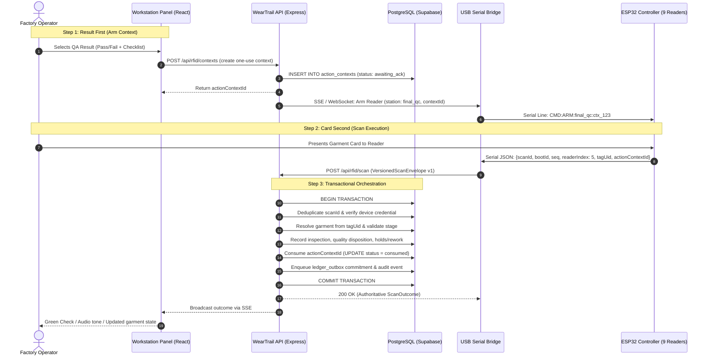

# WearTrail Integration Audit & Application Health Report

**Audit Date:** 19 November 2026  
**Repository Branch:** `integration/audit-checkpoint`  
**Auditor:** Member 1 (Platform & Integration Lead)  
**Status:** Integrated Checkpoint Created & Audited across All 4 Member Branches  

---

## 1. Executive Summary

WearTrail has reached a critical integration milestone. All four member feature branches have been merged into the unified integration branch `integration/audit-checkpoint`:
- **Member 1 (`origin/ahmed`):** Shared Express/TypeScript platform foundation, Prisma 7 database configuration, scan contracts, Hardhat 3 blockchain commitment store, and test harness.
- **Member 4 (`origin/areeba`):** Staff access, scrypt password hashing, session tokens, ActorContext builder, customer-facing public journey, public cryptographic proof, user administration, and audit views.
- **Member 2 (`origin/basim`):** Materials receiving, stock accounting, production orders, material issuing, cutting enrollment with multi-card split (Card A bundle, Cards B/C garments), routine stitching/finishing station panels, and task registers.
- **Member 3 (`origin/daniyal`):** Lot incoming QC, pre-scan QA decision-first flow, quality holds & rework cases, independent reinspection verification, packing eligibility gate, warehouse movements, and outbound shipment gate.

### Actual Completion State
The project currently exhibits **two distinct, highly functional halves that are not yet connected across their runtime boundary**:
1. **The Frontend & Mock Domain Layer is 100% Complete & Passing:** All 26 planned UI routes compile, build (`npm run build` in 1.25s), and run cleanly. The rich domain logic across materials, cutting, routine production, quality holds, rework, packing, shipments, auth, and public journey is thoroughly verified through **57 passing integration and workflow tests** executing against the browser-local mock engine (`src/mock/engine.ts`).
2. **The Database & Blockchain Foundation is 100% Verified:** The shared Prisma 7 ORM connects to the live Supabase PostgreSQL database (`aws-1-ap-southeast-1.pooler.supabase.com:5432`) under private schema `supplyease` (59 tables) with verified TLS certificates. Baseline migration `20261118_weartrail_rfid_v1` is applied. The smart contract `WearTrailCommitmentStore.sol` is fully tested with **22 passing Hardhat tests** enforcing owner authorization, idempotency, and conflict rejection.
3. **The Core Integration Gap (The "Mock Island"):** The frontend UI remains wired to `createMockClient` in [src/lib/data/provider.tsx](file:///C:/Users/mahme/Documents/supply chain project/WearTrail/src/lib/data/provider.tsx#L16). The Express application in [src/server/app.ts](file:///C:/Users/mahme/Documents/supply chain project/WearTrail/src/server/app.ts) currently mounts only health probes (`/healthz`, `/ready`), while domain endpoints (`/api/materials`, `/api/production`, `/api/quality`, `/api/fulfilment`, `/api/auth`, `/api/rfid`, `/api/public`) are not yet routed to live Prisma queries. Connecting the frontend `WearTrailClient` to a live Express HTTP client and wiring the scan orchestrator to live transactions is the remaining bridge to complete production readiness.

---

## 2. Branch Audit Table

| Branch Name | Audited Commit SHA | Purpose & Scope | Integration Status | Merge Resolution Notes |
|---|---|---|---|---|
| **Baseline** | `1f946d723a9ffd4a99ab20f67abdcce3b3006599` | Server-only Prisma 7 foundation & environment configuration | Common Base | Pinned Prisma 7, Supabase session pooler configuration, verified TLS cert setup. |
| **Member 1 (`origin/ahmed`)** | `8cf956399dd5495a777e1fb6784472b3e5c9fd60` | Express foundation, middleware, RFID & workstation contracts, Hardhat commitment store | Base for Checkpoint | Established `src/server/`, `packages/blockchain/`, server tests, and atomic transaction helper `runInTransaction`. |
| **Member 4 (`origin/areeba`)** | `df852b881335b7194f42f741ae01a248f2195dfb` | Staff access, auth hashing, ActorContext, public journey & proof UI, admin/audit/reports | Merged (`f8da4bc`) | **Conflicts Resolved:** Kept Member 1's validated `schema.prisma` (13 relation fixes for Prisma 7 vs unvalidated raw introspection); preserved verified TLS with CA certs in `check-db-connection.ts` (areeba had set `rejectUnauthorized: false`). |
| **Member 2 (`origin/basim`)** | `93ac97e9d7211ba10dd065dd6774ecfa324545bc` | Materials, production orders, issuing, cutting enrollment, routine production, station panels | Merged (`f719e8a`) | **Conflicts Resolved:** Combined Member 4 auth types and Member 2 product spec types in `src/domain/types.ts`; merged fixtures; kept Member 2's authoritative `GarmentsView.tsx`; preserved verified TLS in `src/server/db/pool.ts`. |
| **Member 3 (`origin/daniyal`)** | `2eb200e65c010a3dd9195b6c3697a3a60c8e2270` | Incoming lot QC, pre-scan QA decision, rework cases, independent reinspection, fulfilment gates | Merged (`ee98591`) | **Conflicts Resolved:** Harmonized `releaseHold` in `src/domain/permissions.ts` to accept either `reworkCase?: ReworkCase \| null` or `repairPerformerId?: string`, satisfying both Member 3 and Member 4 signatures while enforcing the independent reinspector rule; preserved verified TLS. |
| **Checkpoint Fix** | `28b37fe9fdf6d2ba7cb84a51167439009ce43dbf` | Post-merge syntax cleanup | HEAD of `integration/audit-checkpoint` | Removed stray closing brace at line 72 of `src/domain/types.ts`. All 57 tests passing. |

---

## 3. Feature and Boundary Matrix

Status Definitions:
- **`[VERIFIED REAL]`**: Verified against real dependencies (live Supabase PostgreSQL, Hardhat local blockchain, real cryptographic routines).
- **`[VERIFIED MOCK]`**: Verified through automated tests and interactive UI against the mock engine/isolated harness.
- **`[IMPLEMENTED UNVERIFIED]`**: Implemented in code/contracts but not yet verified with live database transactions or live network calls.
- **`[MISSING]`**: Required by the authoritative scope but not yet created.
- **`[INCORRECT / BLOCKED]`**: Deviates from architectural invariants or blocked by missing seams.

| Feature Area | Owner | Approved Requirement | Current Status | Supporting Files | Identified Gaps |
|---|---|---|---|---|---|
| **Database Connectivity** | Member 1 | Connect to Supabase PostgreSQL pooler on port 5432 with verified TLS and private `supplyease` schema. | **`[VERIFIED REAL]`** | [src/server/db/pool.ts](file:///C:/Users/mahme/Documents/supply chain project/WearTrail/src/server/db/pool.ts), [scripts/check-db-connection.ts](file:///C:/Users/mahme/Documents/supply chain project/WearTrail/scripts/check-db-connection.ts) | Node warning regarding `pg-connection-string` SSL mode alias (addressed via explicit CA cert). |
| **Prisma 7 Setup & Baseline** | Member 1 | Single shared Prisma client, introspected models, 13 custom relation fixes, applied baseline migration. | **`[VERIFIED REAL]`** | [prisma/schema.prisma](file:///C:/Users/mahme/Documents/supply chain project/WearTrail/prisma/schema.prisma), [src/server/db/client.ts](file:///C:/Users/mahme/Documents/supply chain project/WearTrail/src/server/db/client.ts) | Prisma cannot represent custom triggers or partial indexes natively; relies on PostgreSQL enforcement. |
| **Express Foundation** | Member 1 | Request correlation IDs, CORS allowlist, body bounds, `/healthz` & `/ready` probes, standard error responses. | **`[VERIFIED REAL]`** | [src/server/app.ts](file:///C:/Users/mahme/Documents/supply chain project/WearTrail/src/server/app.ts), [src/server/middleware/](file:///C:/Users/mahme/Documents/supply chain project/WearTrail/src/server/middleware/) | Domain routes (`/api/*`) are not yet mounted in `app.ts`. |
| **Smart Contract & Hashing** | Member 1 | Append-only commitment store, writer auth, identical retry idempotency, conflicting write revert, canonical SHA-256. | **`[VERIFIED REAL]`** | [packages/blockchain/contracts/WearTrailCommitmentStore.sol](file:///C:/Users/mahme/Documents/supply chain project/WearTrail/packages/blockchain/contracts/WearTrailCommitmentStore.sol), [src/domain/canonical.ts](file:///C:/Users/mahme/Documents/supply chain project/WearTrail/src/domain/canonical.ts) | 22 Hardhat tests passing; contract registered in DB table `supplyease.ledger_deployments`. |
| **Ledger Commitments & Outbox** | Member 1 | Atomic transaction-scoped internal/public commitment creation, `sha256_nonce_v1` formula, outbox enqueueing. | **`[VERIFIED REAL / HARNESS]`** | [src/server/ledger/commitment-service.ts](file:///C:/Users/mahme/Documents/supply chain project/WearTrail/src/server/ledger/commitment-service.ts), [docs/LEDGER_PRE_INTEGRATION.md](file:///C:/Users/mahme/Documents/supply chain project/WearTrail/docs/LEDGER_PRE_INTEGRATION.md) | Verified active deployment in PostgreSQL DB; 12 unit tests passing in `src/test/ledger-commitments.test.ts`. Outbox worker daemon remains pending. |
| **Staff Auth & ActorContext** | Member 4 | Secure password hashing (`scrypt`), credential tokens, session lifecycle, role/department authorization. | **`[VERIFIED REAL / MOCK]`** | [src/server/auth/actor-context.ts](file:///C:/Users/mahme/Documents/supply chain project/WearTrail/src/server/auth/actor-context.ts), [src/domain/permissions.ts](file:///C:/Users/mahme/Documents/supply chain project/WearTrail/src/domain/permissions.ts) | Session store in `actor-context.ts` uses in-memory Map; needs persistence to `supplyease.staff_sessions`. |
| **Materials & Receipts** | Member 2 | Supplier lot receipt, unit tracking, material issue reducing stock balances, no order-level RFID cards. | **`[VERIFIED MOCK]`** | [src/features/material-lots/](file:///C:/Users/mahme/Documents/supply chain project/WearTrail/src/features/material-lots/), [src/mock/engine.ts](file:///C:/Users/mahme/Documents/supply chain project/WearTrail/src/mock/engine.ts#L430) | Implemented only in browser mock engine; Express Prisma service not yet wired. |
| **Cutting Enrollment & Lineage** | Member 2 | Multi-card split (Card A remains bundle card; Cards B/C bind distinct garments), order & source attribution. | **`[VERIFIED MOCK]`** | [src/features/workstation/CuttingPanel.tsx](file:///C:/Users/mahme/Documents/supply chain project/WearTrail/src/features/workstation/CuttingPanel.tsx), [src/mock/engine.ts](file:///C:/Users/mahme/Documents/supply chain project/WearTrail/src/mock/engine.ts#L910) | UI talks to mock client. No real database insertion of `garments` and `rfid_tag_bindings`. |
| **Routine Production Scans** | Member 2 | Station scans at Stitching and Finishing advance garment stage; reject unknown cards or wrong stages. | **`[VERIFIED MOCK]`** | [src/features/workstation/RoutinePanel.tsx](file:///C:/Users/mahme/Documents/supply chain project/WearTrail/src/features/workstation/RoutinePanel.tsx), [src/mock/engine.ts](file:///C:/Users/mahme/Documents/supply chain project/WearTrail/src/mock/engine.ts#L1060) | Express routine scan handler is not yet wired. |
| **Incoming Material QC** | Member 3 | Lot-level incoming inspection by Role 'Q'; balances quantities (`accepted + held + rejected === received`). | **`[VERIFIED MOCK]`** | [src/features/quality/QualityView.tsx](file:///C:/Users/mahme/Documents/supply chain project/WearTrail/src/features/quality/QualityView.tsx), [src/server/quality/quality-service.ts](file:///C:/Users/mahme/Documents/supply chain project/WearTrail/src/server/quality/quality-service.ts#L43) | `executeIncomingQc` in `quality-service.ts` is an in-memory stub that does not write to Prisma. |
| **Final QA Pre-Scan Decision** | Member 3 | Result-first card-second flow: inspector selects Pass/Fail, arms reader, card scan resolves garment and commits inspection. | **`[VERIFIED MOCK]`** | [src/features/workstation/QAPanel.tsx](file:///C:/Users/mahme/Documents/supply chain project/WearTrail/src/features/workstation/QAPanel.tsx), [src/mock/engine.ts](file:///C:/Users/mahme/Documents/supply chain project/WearTrail/src/mock/engine.ts#L1180) | Card scan does not trigger real backend context consumption or DB transactions. |
| **Quality Holds & Rework** | Member 3 | Failed QA atomically opens garment hold and rework case; repair alone cannot release; independent reinspector required. | **`[VERIFIED MOCK]`** | [src/features/rework/](file:///C:/Users/mahme/Documents/supply chain project/WearTrail/src/features/rework/), [src/domain/permissions.ts](file:///C:/Users/mahme/Documents/supply chain project/WearTrail/src/domain/permissions.ts#L180) | Rules verified in mock tests; live PostgreSQL transaction writing `garment_holds` and `rework_cases` pending. |
| **Packing & Fulfilment Gate** | Member 3 | Garment must have zero active holds and passing inspection; packed into open packages; warehouse binning; shipment gate. | **`[VERIFIED MOCK]`** | [src/features/fulfilment/](file:///C:/Users/mahme/Documents/supply chain project/WearTrail/src/features/fulfilment/), [src/server/fulfilment/fulfilment-service.ts](file:///C:/Users/mahme/Documents/supply chain project/WearTrail/src/server/fulfilment/fulfilment-service.ts) | Service validates eligibility in memory; database mutations are pending. |
| **Public Customer Journey** | Member 4 | Anonymous garment story by public ID; strictly allowlisted fields; no internal defects, staff IDs, or secrets exposed. | **`[VERIFIED MOCK]`** | [src/routes/p.$publicId.tsx](file:///C:/Users/mahme/Documents/supply chain project/WearTrail/src/routes/p.$publicId.tsx), [src/features/public/PublicJourneyView.tsx](file:///C:/Users/mahme/Documents/supply chain project/WearTrail/src/features/public/PublicJourneyView.tsx) | Fetches from mock projection rather than live PostgreSQL query. |
| **Public Cryptographic Proof** | Member 4 | View exact canonical UTF-8 payload bytes, SHA-256 hash, and verify on-chain commitment status with copy buttons. | **`[VERIFIED MOCK]`** | [src/routes/p.$publicId.proof.tsx](file:///C:/Users/mahme/Documents/supply chain project/WearTrail/src/routes/p.$publicId.proof.tsx), [src/features/public/PublicProofView.tsx](file:///C:/Users/mahme/Documents/supply chain project/WearTrail/src/features/public/PublicProofView.tsx) | Displays mock commitment state rather than querying live smart contract / database. |
| **RFID Scan Envelope & Routing** | Member 1 | Normalized tag UID, authenticated device ID, bootId/sequence, readerIndex mapping, transaction orchestration. | **`[VERIFIED REAL / HARNESS]`** | [src/server/contracts/rfid.ts](file:///C:/Users/mahme/Documents/supply chain project/WearTrail/src/server/contracts/rfid.ts), [src/server/rfid/scan-router.ts](file:///C:/Users/mahme/Documents/supply chain project/WearTrail/src/server/rfid/scan-router.ts), [src/server/routes/rfid.ts](file:///C:/Users/mahme/Documents/supply chain project/WearTrail/src/server/routes/rfid.ts) | Real endpoint `POST /api/rfid/scan` mounted; 25 automated isolated tests passing in `src/test/scan-ingestion.test.ts`. |
| **Ledger Outbox Worker Daemon**| Member 1 | Asynchronous process leasing pending rows from `supplyease.ledger_outbox`, submitting to Ethereum, reconciling receipts. | **`[MISSING]`** | Contract tests pass, schema exists in DB, but outbox worker script/service is not written. | Needs `scripts/ledger-worker.ts` or `src/server/ledger/outbox-worker.ts`. |
| **USB Serial Bridge** | Member 1 | Node.js serial port listener (`serialport`) connecting to ESP32 USB COM port, reading JSON lines, forwarding to Express. | **`[MISSING]`** | Hardware contracts defined; actual Node serial forwarder script not created. | Needs `packages/bridge/` or `scripts/usb-serial-bridge.ts`. |
| **HTTP WearTrailClient** | Member 1 | Browser client implementing `WearTrailClient` via `fetch()` against Express REST endpoints. | **`[MISSING]`** | [src/lib/data/client.ts](file:///C:/Users/mahme/Documents/supply chain project/WearTrail/src/lib/data/client.ts), [src/lib/data/provider.tsx](file:///C:/Users/mahme/Documents/supply chain project/WearTrail/src/lib/data/provider.tsx) | App currently uses `createMockClient` exclusively. Needs `src/lib/data/http-client.ts`. |

---

## 4. Schema and Contract Compatibility

### A. Prisma Schema vs. PostgreSQL Triggers & Constraints
1. **Private Schema Encapsulation:**
   The live Supabase database uses schema `supplyease` (59 tables). The introspected Prisma schema is mapped via `@@schema("supplyease")`.
2. **Relations Workaround in Prisma 7:**
   Prisma 7 introspection does not automatically discover relations across PostgreSQL tables when foreign key names or composite keys do not follow simple conventions. Member 1 manually added 13 explicit `@relation` attributes in `prisma/schema.prisma` (e.g. `checkpoints`, `rfid_stations`, `garments`, `material_lots`).
   - *Risk:* If another member runs `prisma db pull` without merging, it will overwrite these 13 relations and break client generation.
3. **Database Constraints & Triggers Not Expressed in Prisma:**
   - `trg_prevent_material_overconsumption`: Checks that cutting consumption does not exceed issued quantity.
   - `trg_prevent_garment_cross_order_reassignment`: Blocks reassignment of garments across orders.
   - `trg_enforce_single_active_hold_per_garment`: Ensures garment hold integrity.
   - `rfid_tags_active_garment_uq`: Partial unique index (`WHERE unbound_at IS NULL`) preventing duplicate active tag bindings.
   - *Implication:* Backend services must rely on PostgreSQL throwing constraint violations on bad inserts/updates, and catch them via `prismaErrorHandler` or transaction rollbacks.

### B. ActionContext Lifecycle DTO Mismatch
There is an enum naming conflict between the frontend domain types and the backend server contracts:
- In [src/domain/types.ts](file:///C:/Users/mahme/Documents/supply chain project/WearTrail/src/domain/types.ts#L134):
  ```ts
  export type ActionContextStatus =
    | "awaiting-ack"
    | "ready"
    | "processing"
    | "consumed"
    | "expired"
    | "cancelled";
  ```
- In [src/server/contracts/rfid.ts](file:///C:/Users/mahme/Documents/supply chain project/WearTrail/src/server/contracts/rfid.ts#L92):
  ```ts
  export type ActionContextStatus =
    | "awaiting_ack"
    | "ready"
    | "processing"
    | "confirmed"
    | "expired"
    | "cancelled";
  ```
- *Defect:* Notice `consumed` (hyphenated) vs `confirmed` (underscored). When the frontend sends `consumed` or `awaiting-ack` to the Express backend, validation will fail unless normalized.

### C. Station Code Alignment
Station codes are 100% aligned across the entire stack (`fabric_receiving`, `fabric_issue`, `cutting`, `stitching`, `finishing`, `final_qc`, `packing`, `warehouse`, `dispatch`). This matches `supplyease.rfid_stations` in the database, `RfidStationCode` in `src/domain/types.ts`, and `src/server/contracts/rfid.ts`.

---

## 5. Scan and Hardware Architecture Audit

### Required Hardware Flow


### Current Implementation State
- **Station Panels:** Completed for all stations (`ReceivingPanel.tsx`, `IssuePanel.tsx`, `CuttingPanel.tsx`, `RoutinePanel.tsx`, `QAPanel.tsx`, `LogisticsPanel.tsx`). They support both simulated scans and real scan outcome display.
- **Envelope Definition:** `VersionedScanEnvelope` v1 is fully typed in `src/server/contracts/rfid.ts` with device ID, bootId, sequence, readerIndex, mappingVersion, tagUid, actionContextId, and uptime.
- **Gaps:**
  1. The USB serial bridge is completely unwritten.
  2. The Express endpoint `POST /api/rfid/scan` does not exist in `src/server/app.ts`.
  3. The scan router (`IScanRoutingService`) is stubbed in `src/server/contracts/pending.ts` and throws `501 PendingImplementationError`.
  4. The station panels talk directly to `createMockClient()`.

---

## 6. Ledger and Public Journey Audit

### A. Smart Contract Implementation (`WearTrailCommitmentStore.sol`)
- **Address & Deployment:** Compiled with Hardhat 3. Tests verify:
  - Contract owner and writer authorization control.
  - Idempotent identical writes (`recordCommitment` with same ID and hash succeeds with `isNew: false`).
  - Conflicting write rejection (`ConflictingCommitment` revert when same ID is submitted with a different hash).
  - Empty hash/ID rejection.
  - Batch commitment execution.
- **Database Registration:** Active deployment verified in PostgreSQL table `supplyease.ledger_deployments`:
  - Deployment ID: `7c41dac6-1687-4608-a9ce-bee3c57179f3`
  - Code: `local-hardhat-20261119150320-1c094d99`
  - Chain ID: `31337`
  - Contract Address: `0x5FbDB2315678afecb367f032d93F642f64180aa3`
  - Tx Hash: `0x1c094d99ba4fa2e1f19944fb3f219269866ec39ca09abab50f358e8ef69a7819`
- **Integration Status:** Full transaction-scoped commitment and outbox enqueueing implemented in [src/server/ledger/commitment-service.ts](file:///C:/Users/mahme/Documents/supply chain project/WearTrail/src/server/ledger/commitment-service.ts). Background broadcast worker daemon is pending.

### B. Canonical Serialization & Hashing (`src/domain/canonical.ts` & `src/server/ledger/commitment-service.ts`)
- **Implementation:** Recursively sorts object keys, formats UTF-8 string without whitespace, and produces consistent SHA-256 digests.
- **Formulas & Compliance:**
  - Internal Factory Events: `SHA256(nonce || canonicalBytes)` using `sha256_nonce_v1`, with private unpredictable 32-byte nonces generated via `crypto.randomBytes(32)`. Fully satisfies PostgreSQL constraint `ledger_commitment_hash_scheme` and trigger `protect_new_private_commitment`.
  - Public Commitments: `sha256` of canonical public payload bytes; internal nonces and internal payload bytes strictly kept `NULL`.
- **Status:** Verified with automated unit tests in `src/test/access-public.test.ts` and `src/test/ledger-commitments.test.ts`.

### C. Public Customer Experience (`/p/:publicId`)
- **Views:** [PublicJourneyView.tsx](file:///C:/Users/mahme/Documents/supply chain project/WearTrail/src/features/public/PublicJourneyView.tsx) and [PublicProofView.tsx](file:///C:/Users/mahme/Documents/supply chain project/WearTrail/src/features/public/PublicProofView.tsx) provide an interactive timeline, human-readable status cards, and cryptographic proof inspector.
- **Privacy Enforcement:** [src/mock/projection.ts](file:///C:/Users/mahme/Documents/supply chain project/WearTrail/src/mock/projection.ts) strictly strips staff user IDs, internal nonces, defect descriptions, rework history, and supplier internal IDs before returning data to the public shopper.
- **Gap:** Currently powered by the mock projection rather than a database query against `supplyease.garments` and `supplyease.public_payload_versions`.

---

## 7. Integration Defects and Inconsistencies

1. **The "Mock Island" Architecture Decoupling:**
   - The entire React application is wrapped in `<DataProvider client={createMockClient(getSessionUserId)}>` ([src/lib/data/provider.tsx](file:///C:/Users/mahme/Documents/supply chain project/WearTrail/src/lib/data/provider.tsx#L16)). It has zero interaction with the Express server running on port 3001 or the live Supabase PostgreSQL database.
2. **ActionContext Status Enum Discrepancy:**
   - Frontend `types.ts` defines `consumed` and `awaiting-ack`.
   - Backend `rfid.ts` defines `confirmed` and `awaiting_ack`.
   - This mismatch will cause schema validation errors when the bridge posts scan envelopes.
3. **In-Memory Session Store in ActorContext:**
   - In [src/server/auth/actor-context.ts](file:///C:/Users/mahme/Documents/supply chain project/WearTrail/src/server/auth/actor-context.ts#L44), sessions are kept in `const sessionStore = new Map<string, StaffSession>();`.
   - Restarting Express logs out all users. Must be connected to `supplyease.staff_sessions`.
4. **Member 3 Quality Services are In-Memory Stubs:**
   - In [src/server/quality/quality-service.ts](file:///C:/Users/mahme/Documents/supply chain project/WearTrail/src/server/quality/quality-service.ts#L43), `executeIncomingQc` accepts `tx: PrismaTransactionClient`, but never executes any queries on `tx`. It returns an in-memory object literal.
   - In [src/server/fulfilment/fulfilment-service.ts](file:///C:/Users/mahme/Documents/supply chain project/WearTrail/src/server/fulfilment/fulfilment-service.ts#L25), `validatePackingOperation` only runs in-memory logic.
5. **No Domain Routes Mounted in Express:**
   - [src/server/app.ts](file:///C:/Users/mahme/Documents/supply chain project/WearTrail/src/server/app.ts) only mounts `healthRouter`.
   - Any HTTP request to `/api/materials`, `/api/orders`, `/api/quality`, `/api/rfid`, or `/api/auth` returns `404 Not Found`.
6. **Vite Externalization of Node Crypto:**
   - Build log shows `Module "node:crypto" has been externalized for browser compatibility, imported by src/domain/canonical.ts`.
   - In browser runtime, calling Node's `node:crypto` directly in `canonical.ts` will fail unless polyfilled or adapted for Web Crypto API (`window.crypto.subtle`).

---

## 8. Environment, Build, and Test Health

### Test Suites
```bash
$ npm test
✓ src/test/ledger-commitments.test.ts (12 tests)
✓ src/test/materials-production.test.ts (9 tests)
✓ src/test/quality-fulfilment.test.ts (9 tests)
✓ src/test/access-public.test.ts (13 tests)
✓ src/test/workflow.test.ts (11 tests)
✓ src/test/scan-ingestion.test.ts (25 tests)
✓ src/test/server-foundation.test.ts (14 tests)
✓ src/test/app-routing.test.tsx (1 test)

Test Files  8 passed (8)
     Tests  94 passed (94)
```

### Blockchain Test Suites
```bash
$ npm run blockchain:test
  WearTrailCommitmentStore
    Deployment & Authorization (7 tests)
    Authorized Writes & Event Emission (5 tests)
    Retrieval Operations (3 tests)
    Idempotency (Identical Retries) (2 tests)
    Conflicting Writes (1 test)
    Batch Commitments (4 tests)

  22 passing (476ms)
```

### Production Build
```bash
$ npm run build
✓ 2116 modules transformed.
✓ built in 1.25s
[nitro] √ You can preview this build using npx vite preview
```

### Type Checking
```bash
$ npx tsc --noEmit
# Exits with code 0 (Zero errors)
```

### Live Database Connectivity
```bash
$ npm run db:check
DATABASE_URL configured: Yes
MIGRATION_DATABASE_URL configured: Yes
Connection SUCCESSFUL!
- Database Name:       postgres
- Database User:       weartrail_api
- Active Schema:       supplyease
- Tables in supplyease: 59
Testing Prisma Client ORM query on 'supplyease' schema...
- Prisma Client query SUCCESS: 9 stations found in rfid_stations.
```

---

## 9. Member-by-Member Remaining Work

### Member 1: Platform & Integration Lead
1. **Implement Core Scan Orchestrator (`src/server/rfid/scan-router.ts`) [COMPLETED ON `backend/live`]:**
   - Implemented real transaction-scoped scan processing with `POST /api/rfid/scan`.
   - Deduplicates incoming `VersionedScanEnvelope` by `scanId` and `(bootId, sequence)` against database.
   - Dispatches to Cutting enrollment handler or Final QA handler under interactive transaction.
   - 25 automated tests passing in `src/test/scan-ingestion.test.ts`. Hand-off guide in `docs/SCAN_PIPELINE_HANDOFF.md`.
2. **Mount Remaining Express Domain Routers in `src/server/app.ts`:**
   - Mount routes for `/api/auth`, `/api/materials`, `/api/production`, `/api/quality`, `/api/fulfilment`, and `/api/public`.
3. **Build HTTP Data Client (`src/lib/data/http-client.ts`):**
   - Implement `WearTrailClient` using `fetch()` against Express API, enabling browser toggle between mock and live backend.
4. **Build USB Serial Bridge Forwarder (`scripts/usb-serial-bridge.ts`):**
   - Listen to USB serial port, parse JSON scan lines, attach device credentials, and forward to Express `POST /api/rfid/scan`.
5. **Implement Ledger Outbox Worker (`scripts/ledger-worker.ts`):**
   - Poll `supplyease.ledger_outbox` for pending commitments, execute `recordCommitment` on the smart contract, and update status to `confirmed`.

### Member 2: Materials & Production
1. **Implement Prisma Services for Materials & Orders:**
   - Create `src/server/materials/material-service.ts` to insert `material_lots` and `material_stock_movements`.
   - Create `src/server/production/order-service.ts` to create `production_orders` and issue materials.
2. **Implement Cutting Enrollment Handler:**
   - Write transactional logic creating `garments` and binding active tag UIDs in `rfid_tag_bindings` with multi-card lineage (Card A bundle, Cards B/C garments).
3. **Implement Routine Production Handler:**
   - Advance `garments.current_stage` at Stitching and Finishing stations.

### Member 3: Quality & Fulfilment
1. **Implement Database-Backed Quality Service:**
   - Replace in-memory stubs in `src/server/quality/quality-service.ts` with Prisma queries creating `inspections`, updating lot acceptance, and inserting `garment_holds` and `rework_cases`.
2. **Implement Database-Backed Fulfilment Service:**
   - Replace in-memory stubs in `src/server/fulfilment/fulfilment-service.ts` with queries creating `packages`, `package_items`, `warehouse_movements`, and `shipments`.
3. **Enforce Independent Reinspection in SQL:**
   - Ensure reinspection transactions query `repair_records` to block repairer self-approval.

### Member 4: Staff Access & Public Journey
1. **Persist Sessions to PostgreSQL:**
   - Migrate `sessionStore` in `src/server/auth/actor-context.ts` to query and write `supplyease.staff_sessions`.
2. **Implement Express Auth Routes:**
   - Create `/api/auth/login`, `/api/auth/logout`, `/api/auth/me`, and `/api/auth/credentials/:token/claim`.
3. **Implement Live Public Journey Route:**
   - Create `GET /api/public/p/:id` querying `supplyease.garments` and `public_payload_versions`, returning allowlisted customer journey data.
4. **Browser Crypto Compatibility:**
   - Update `src/domain/canonical.ts` to use Web Crypto API when running in the browser so public proof hashing works client-side.

---

## 10. Recommended Immediate Next Step

### Smallest Concrete End-to-End Milestone:
**"Simulated Cutting Enrollment to Live PostgreSQL Database"**

To connect the two decoupled halves of the application with the lowest possible risk, execute this vertical slice next:
1. **Member 1** creates `POST /api/rfid/scan` in Express and implements the scan router.
2. **Member 2** provides the cutting enrollment transaction logic: inserting one garment into `supplyease.garments` and its RFID tag binding into `supplyease.rfid_tag_bindings`.
3. **Verification:** Send a simulated `VersionedScanEnvelope` for Station 3 (`cutting`) with tag UID `E280116060000204` to `http://localhost:3001/api/rfid/scan`. Verify via `npm run db:check` that the row is committed to Supabase PostgreSQL and retrieved via Prisma Client.
